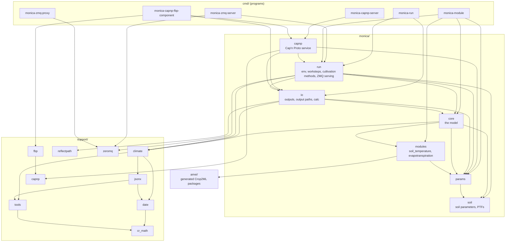
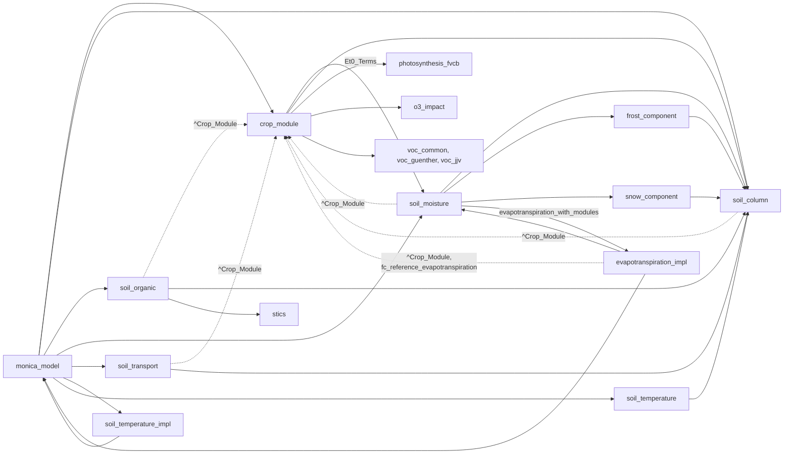
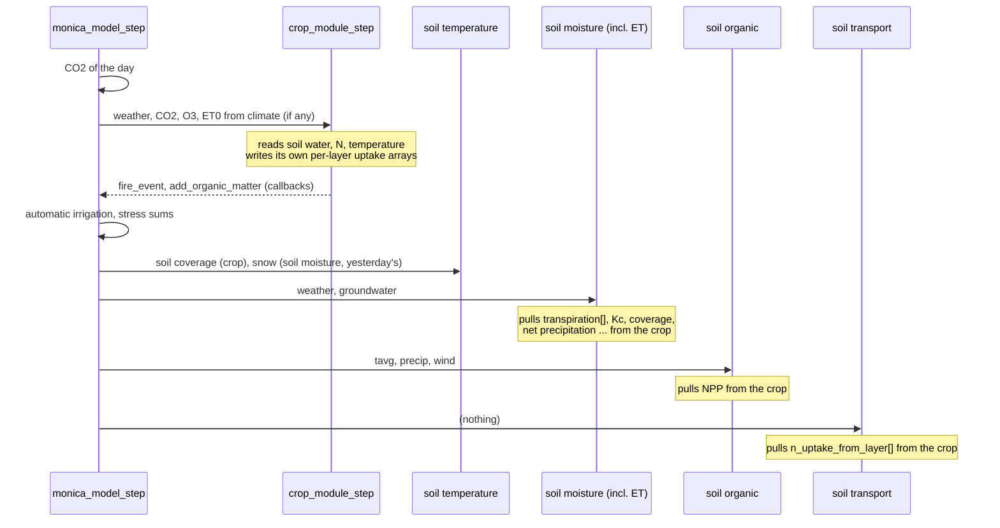
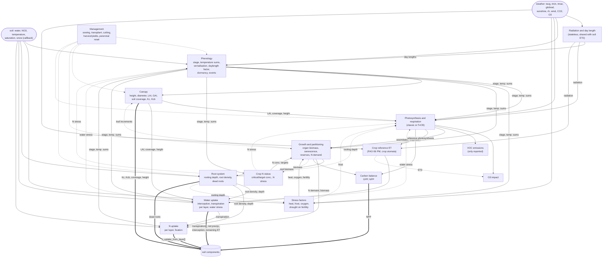

# The Odin MONICA's structure: dependencies, and how the crop module could be split

A map of what depends on what in the Odin MONICA (as of `ac1002f1`), and an
analysis of `monica/core/crop_module.odin`: which single-purpose components it
consists of, which data flows between them, and what stands in the way of
making them separate. The numbers come from scanning the code (imports,
references between files, and for the crop module which `Crop_Module` fields
each procedure reads and writes); the conclusions were checked by hand.

Apart from the bindings' previous-day state (section 11), nothing here
changes the code. It is a basis for deciding where MONICA's interfaces should
be. Sections 7-10 look at the other modules, sketch the two new structs the
plan needs (previous-day values, crop-soil exchange), and estimate what such
explicit interfaces cost; section 11 explains Crop2ML's `s`/`s1` and rates and
states, and how MONICA relates to them; section 12 discusses how components
could declare their inputs and outputs (global map vs. parameters vs.
per-component structs with tagged metadata) and lists designs left out for
compatibility.

The scans can be repeated with `tools/field_deps.py` (run from `odin/`):

    pixi run python tools/field_deps.py files monica/core
    pixi run python tools/field_deps.py fields monica/core/crop_module.odin Crop_Module cm
    pixi run python tools/field_deps.py lag monica/core/crop_module.odin Crop_Module cm crop_module_step
    pixi run python tools/field_deps.py fields monica/core/soil_moisture.odin Soil_Moisture sm --soil sm.soil_column
    pixi run python tools/field_deps.py writers monica/core/soil_column.odin Soil_Layer monica

`files`: which file uses which other file's declarations; `fields`: per
procedure the struct's fields written and read (including those of the
procedures it calls), soil values read, procedures called; `lag`: the fields
the step reads before they are written that day - the previous day's values;
`writers`: which files and procedures assign each field of a struct.
It is a text scan, not a parser: check what matters by hand.

## 1. Packages



(Edges to `support/date`, `tools`, `jsonx` and `cr_math` from most packages
left out.) The package level is clean: no cycles, and the layers are clear -
programs → `run`/`capnp` → `io` → `core` → `modules` → `amei`, with `params`
and `soil` below `core`. `monica/trace` is unused.

**The problem is inside `core`**: one package with 17 files, among them
`crop_module.odin` (4116 lines, 72 procedures, 172 fields in `Crop_Module`).
Package boundaries don't say anything about the model's structure.

## 2. Inside `core`

References between the files of `core` (an arrow: uses a declaration of; the
number: how many references):



The dotted arrows close cycles: the crop module reads the soil column, and
four soil components hold a `^Crop_Module` and read crop fields themselves.
The crop module also reaches back into the model through three callbacks that
`monica_model.odin` implements over a package-global `g_current_model`:

| Callback | Implemented by | Used in |
|---|---|---|
| `fire_event(name)` | `current_events[name] = true` | `crop_module_step` (emergence, anthesis, maturity, stages, stem elongation) |
| `add_organic_matter(layer → amount, N conc.)` | `soil_organic_add_organic_matter` | dead roots (`fc_move_dead_root_biomass_to_soil`), `apply_cutting` |
| `get_snow_depth_and_calc_temp_under_snow(tavg)` | `soil_moisture`'s snow component | `fc_frost_kill` |

### The crop ↔ soil interface today

Good news: the crop never writes into the soil column's layers directly. Water
and nitrogen uptake are written into the crop's own per-layer arrays, and the
soil components pull them. So the interface is already *narrow* - it is only
not *declared*: it consists of whatever fields the other side happens to read.

| Direction | Reader | Fields |
|---|---|---|
| crop → soil moisture | `soil_moisture.odin` | `transpiration[]`, `soil_coverage`, `kc_factor`, `kcb_factor`, `developmental_stage`, `net_precipitation`, `evaporated_from_intercept`, `remaining_evapotranspiration`, `reference_evapotranspiration`, `rooting_depth`, `crop_height` |
| crop → soil transport | `soil_transport.odin` | `n_uptake_from_layer[]` |
| crop → soil organic | `soil_organic.odin` | `net_primary_production`, plus dead roots and residues through `add_organic_matter` |
| crop → soil column | `soil_column.odin` (automatic irrigation) | `current_total_temperature_sum`, the cultivar's `heat_sum_irrigation_start/_end` |
| crop → soil temperature modules | `soil_temperature_impl.odin` | `leaf_area_index`, `crop_height`, `aboveground_biomass` |
| crop → ET modules | `evapotranspiration_impl.odin` | `transpiration`, `remaining_evapotranspiration`, `evaporated_from_intercept`, `gross_photosynthesis_reference_mol`, species' `carboxylation_pathway`, and it *calls* `fc_reference_evapotranspiration` on a copy of the crop |
| crop → model | `monica_model.odin` | `crop_n_redux`, `transpiration_deficit`, `crop_heat_redux`, `oxygen_deficit` (stress sums), `soil_coverage` (soil temperature), crop params (N-min fertilising) |
| soil → crop | `crop_module.odin` | per layer: `soil_moisture_m3`, `field_capacity`, `permanent_wilting_point`, `saturation`, `soil_no3`, `soil_temperature`, `layer_thickness_m`, `soil_clay_content`, `soil_sand_content`; column: `surface_water_storage`, `soil_surface_temperature`, `groundwater_table_layer_idx`, `number_of_organic_layers`; snow via callback |

**Since phases A and E of `plan-component-interfaces.md`** (branch
`component-interfaces`): the soil components no longer hold a
`^Crop_Module`, and the crop module no longer calls back into the model
(the callbacks and `g_current_model` are gone; the dead roots go to soil
organic through an explicit parameter of the crop step). They get a `Crop_To_Soil` value (`core/crop_to_soil.odin`)
that the model fills at the start of the general step; the automatic
irrigation trigger gets an `Irrigation_Crop_Window`; the crop step returns
its events (`Crop_Events`) and gets the snow state as an input
(`Snow_For_Crop`). Still reading the crop directly: `evapotranspiration_impl`,
for the evapotranspiration modules' inputs (read-only; the crop's ET0 terms
come from the pure `crop_et0`). The tables above describe the state before.

Outside `core`, the outputs read the crop too: `io/build_output.odin` through
about 15 getters (`get_primary_crop_yield`, ...), and `io/output_paths.odin`
names 53 crop fields as output paths. With reflective outputs *every* field
name of `Crop_Module` is effectively public (`crop.<field>` paths) - which
matters for any restructuring (section 6).

## 3. A day



The crop runs first, on the soil state of the end of yesterday; the soil
components then use the crop's results of today.

## 4. The crop module: what it consists of

`crop_module_step` calls, in this order (procedure, lines):

| # | Procedure | Lines | Writes (main fields) | Reads from other parts |
|---|---|---:|---|---|
| 0 | (step: transplant shock, cutting delay) | - | `transplant_efficiency`, `days_since_transplant` | |
| 1 | `fc_radiation` | 84 | `declination`, day lengths, extraterrestrial/clear/overcast radiation, PAR | latitude only |
| 2 | `fc_oxygen_deficiency` | 39 | `oxygen_deficit`, `time_under_anoxia` | soil saturation & moisture, rooting depth |
| 3 | `fc_crop_developmental_stage` | 184 | `developmental_stage`, temperature sums, `growth_cycle_ended`; may reset `crop_params` (perennial) | soil temperature, top-layer moisture, surface water; *yesterday's* water/N stress, daylength & vernalisation factors |
| 4 | (step: events) | - | `anthesis_day`, `maturity_day`, ... | `fire_event` |
| 5 | `fc_daylength_factor`, `fc_vernalisation_factor` | 29 + 63 | `daylength_factor`, `vernalisation_factor`, `vernalisation_days` | day lengths |
| 6 | `fc_kc_factor` + the inline dual-Kc block | 20 + 70 | `kc_factor`, `kcb_factor` | temperature sums |
| 7 | `fc_crop_size`, `fc_crop_green_area`, `fc_soil_coverage` | 39 + 50 + 3 | `crop_height`, `crop_diameter`, `leaf_area_index`, `green_area_index`, `soil_coverage` | *yesterday's* leaf growth/senescence increments |
| 8 | `fc_crop_photosynthesis` | **716** | assimilates, gross photosynthesis, respiration, `gross_photosynthesis_reference_mol`, sunlit/shaded LAI, O3 damage, VOC buffers and emissions | radiation, LAI, CO2, O3; *yesterday's* water, N and frost stress, ET0, rooting depth, green organ biomass; root-zone soil moisture |
| 9 | `fc_heat_stress_impact` | 60 | `crop_heat_redux`, `total_crop_heat_impact` | |
| 10 | `fc_frost_kill` | 60 | `lt50`, `crop_frost_redux` | soil (surface) temperature, snow callback |
| 11 | `fc_drought_impact_on_fertility` | 26 | `drought_impact_on_fertility`; **clamps `transpiration_deficit`** | oxygen deficit |
| 12 | `fc_crop_nitrogen` | 47 | critical/target N concentration, `crop_n_redux`, `root_n_redux` | *yesterday's* biomass and N concentrations |
| 13 | `fc_crop_dry_matter` | **383** | organ biomass (green, dead, increments), totals, reserve pool, N demand, **and the root system**: rooting depth/zone, root density/diameter, total root length; dead roots to the soil | assimilates, all stress factors, soil water & clay |
| 14 | `fc_reference_evapotranspiration` | 109 | `stomata_resistance`, (ET0) | radiation, `gross_photosynthesis_reference_mol` (from 8) |
| 15 | `fc_crop_water_uptake` | 242 | interception, potential/actual transpiration, per-layer `transpiration[]`, `transpiration_deficit`, `net_precipitation`, `remaining_evapotranspiration` | Kc, coverage, height, root density, soil water |
| 16 | `fc_crop_n_uptake` | 192 | per-layer `n_uptake_from_layer[]`, N fixation, N contents | N demand, biomass, root density, soil NO3 & water, transpiration |
| 17 | `fc_gross/net_primary_production` | 4 + 5 | `gross_primary_production`, `net_primary_production` | |

Plus, outside the daily step: construction (`make_crop_module`, 150 lines,
and the parameter cloning), management (`force_transplant_state`,
`apply_cutting`, `set_perennial_crop_parameters`, `set_stage`), intercropping
(`crop_module_ic_send_rcv`, `set_other_crop_height_and_lait`), and about 20
read-only getters for yields, N contents and respiration.

### Previous-day feedbacks

Reads of a field that is written only *later* in the step - i.e. yesterday's
value is used. These are the real loops between the components:

| Reader | Yesterday's | Writer |
|---|---|---|
| development (3) | `transpiration_deficit` | water uptake (15) |
| development (3) | `crop_n_redux` | crop nitrogen (12) |
| development (3) | `daylength_factor`, `vernalisation_factor` | (5) - computed *after* the stage today |
| canopy (7) | leaf growth & senescence increments | dry matter (13) |
| photosynthesis (8) | `transpiration_deficit`, `crop_n_redux`, `crop_frost_redux` | (15), (12), frost (10) |
| photosynthesis (8) | `reference_evapotranspiration` (O3 uptake), `rooting_depth` | ET0 (14), dry matter (13) |
| oxygen deficiency (2) | `rooting_depth` | dry matter (13) |
| crop nitrogen (12) | biomass and N concentrations | dry matter (13), N uptake (16) |

That development uses yesterday's daylength and vernalisation factors is
probably not intended, but it is what the C++ does; a restructuring has to
keep it (CI compares with the C++ value by value) and can at least make it
visible.

### Hidden couplings

Things a split has to deal with, because one part changes another part's data:

1. **Everything takes `^Crop_Module`.** Only 6 of the 17 step procedures
   return their result; the others write fields. A procedure's signature says
   nothing about what it needs or produces - the tables above had to be
   recovered by scanning the bodies.
2. **`fc_drought_impact_on_fertility` clamps `transpiration_deficit`** (to
   ≥ 0), the water uptake's output.
3. **Parameters as state.** `apply_cutting` multiplies the cultivar's
   `max_assimilation_rate`; the perennial reset in
   `fc_crop_developmental_stage` replaces all of `crop_params` mid-step (which
   is why the step reads parameters only through pointers).
4. **Management writes everywhere.** `force_transplant_state` sets
   phenology, canopy, biomass, roots and N state in one go; `apply_cutting`
   biomass, LAI, stage and parameters; `set_stage` is also called from the
   outputs (`io`'s settable "Stage").
5. **The root system lives inside `fc_crop_dry_matter`** (from about line
   2620 on) although it is a separate process with its own state, and is
   needed by oxygen deficiency, photosynthesis, water and N uptake.
6. **ET0 is crop-specific and needs photosynthesis.**
   `fc_reference_evapotranspiration` uses the stomata resistance derived from
   `gross_photosynthesis_reference_mol` (from 8), and
   `evapotranspiration_impl.odin` calls it on a copy of the crop to get the
   ET0 terms - a sign it wants to be a component of its own.
7. **Radiation is duplicated.** `soil_moisture.odin`'s ET0 (around line
   1168) computes declination and the day lengths again, with the same
   formulas as `fc_radiation`. *(Resolved in phase G: it calls
   `crop_radiation`.)*
8. **Callbacks through a global** (`g_current_model`), see section 2.

## 5. Proposed components

Grouping the procedures by the state they own and the data they exchange gives
these components (bold arrows: same day; dashed: yesterday's value):



| Component | From today's code | State it would own | Size now | How separable |
|---|---|---|---:|---|
| Radiation and day length | `fc_radiation`; duplicate in `soil_moisture` | none | 84 | easy - pure function of day, latitude, radiation, sunshine |
| Phenology | `fc_crop_developmental_stage`, `fc_daylength_factor`, `fc_vernalisation_factor`, `set_stage`, anthesis/maturity, dormancy and events from the step, `wang_engel_temperature_response`, temperature-sum getters | stage, temperature sums, vernalisation days, dormancy end, events | ~400 | medium - needs explicit yesterday's stresses; the perennial reset |
| Canopy (a grouping of today's procedures, not an existing component; see section 12) | `fc_crop_size`, `fc_crop_green_area`, `fc_soil_coverage`, `fc_kc_factor`, the dual-Kc block | height, diameter, LAI, GAI, Kc, Kcb | ~180 | easy |
| Photosynthesis and respiration | `fc_crop_photosynthesis` without O3 and VOC | the 24/240-step buffers (if not VOC-only) | ~550 | medium - the biggest procedure, but one purpose; FvCB is already in its own file |
| O3 impact | the O3 part of 8, `o3_impact.odin` | `o3_*` | (in 8) | easy, already half out |
| VOC emissions | `calculate_voc_emissions`, the buffer part of 8, `voc_*.odin` | rad/tfol buffers, emissions | (in 8) | easy - nothing in the model reads the results, only outputs: a natural *driver* |
| Stress factors | `fc_heat_stress_impact`, `fc_frost_kill`, `fc_oxygen_deficiency`, `fc_drought_impact_on_fertility` | lt50, time under anoxia, heat sums | ~190 | easy, each its own function |
| Crop N status | `fc_crop_nitrogen` | the "old" concentrations | 47 | easy |
| Growth and partitioning | first part of `fc_crop_dry_matter` | organ biomass arrays, reserves, totals | ~260 | medium |
| Root system | second part of `fc_crop_dry_matter`, `calc_root_density_factor_and_sum`, `fc_move_dead_root_biomass_to_soil`, `get_effective_rooting_depth` | rooting depth/zone, root density, diameter, length | ~180 | medium - must be cut out of the dry-matter procedure |
| Crop reference ET | `fc_reference_evapotranspiration` | stomata resistance | 109 | easy - and then shareable with `evapotranspiration_impl` |
| Water uptake | `fc_crop_water_uptake` | interception storage, per-layer transpiration | 242 | easy |
| N uptake | `fc_crop_n_uptake` | per-layer uptake, totals | 192 | easy |
| Carbon balance | GPP/NPP, respiration getters | | ~20 | trivial |
| Management | `make_crop_module`, `force_transplant_state`, `apply_cutting`, `set_perennial_crop_parameters`, yield and N-content getters | cut and exported biomass | ~500 | needs a "reset/apply to component" operation per component |

The soil side would see only two declared structs instead of a pointer to the
whole crop: what the crop gives the soil (`transpiration[]`,
`n_uptake_from_layer[]`, Kc, Kcb, coverage, height, net precipitation,
interception, remaining ET, rooting depth, NPP, development stage), and what
the soil gives the crop (the per-layer and column values of the table in
section 2). The soil components' `crop_module: ^Crop_Module` fields would go.

## 6. A way there, without changing a single result

Every step below is a pure restructuring: the same floating-point operations
in the same order, so the CI comparison with the C++ stays identical and
checks each step.

1. **Group the fields, keep the names working.** Split `Crop_Module` into
   sub-structs per component (`Phenology`, `Canopy`, `Root_System`, ...) and
   embed them with `using`: `cm.leaf_area_index` keeps compiling everywhere,
   and the grouping is visible in the type. Outputs: `reflectpath` doesn't
   look through `using` (that's why driver inputs need `input.daily.<field>`),
   so either it learns to flatten `using` fields or the old paths get aliases
   like the moved soil-organic ones.
2. **Narrow the signatures, leaves first.** Radiation, daylength and
   vernalisation factor, Kc, soil coverage, heat, frost, oxygen, crop N:
   each gets its inputs as parameters and returns (or writes into) its own
   sub-struct only. The compiler then checks the dependencies.
3. **Make the previous-day values explicit.** A small struct of yesterday's
   stresses (water, N, frost, rooting depth, leaf increments, ET0), filled at
   the end of the step and read by the next one. Bit-identical, but the
   feedback loops become visible (and the daylength/vernalisation ordering
   quirk becomes a documented line instead of an accident of order).
4. **Cut the two big procedures.** The root system out of
   `fc_crop_dry_matter`; O3 and VOC out of `fc_crop_photosynthesis`.
5. **Declare the crop ↔ soil exchange.** The two structs from section 5,
   filled by the crop step and read by the soil components; remove the soil
   components' `^Crop_Module`. The callbacks become values the step returns
   (events, organic matter to add) or explicit parameters (snow).
6. **Share what is duplicated.** One radiation and day-length function for
   the crop and the soil ET0, one crop ET0 used by the crop and by
   `evapotranspiration_impl`.
7. **Then swappable**, like soil temperature and evapotranspiration: a
   component with declared inputs and outputs fits the `Module_Entry`
   machinery (integrated / driver / standalone, `how-to-use.md`). VOC
   emissions are a driver already in all but name; phenology,
   photosynthesis and water uptake are the obvious next candidates for
   alternative models.

After the crop module, `soil_organic.odin` (1676 lines) and
`soil_moisture.odin` (1483 lines) would deserve the same analysis.

### Field ownership after step 1 (plan-component-interfaces.md C2/C3)

Step 1 is done: `Crop_Module`'s fields are in 16 sub-structs embedded with
`using` (`crop_module.odin`), named after the components of section 5. A
field belongs to the group of the procedure that computes it
(`field_deps.py writers`); the parameters, the soil/site pointers, the
organic-matter callback and the error state stay direct fields.

| Group | Fields |
|---|---:|
| `Crop_Module` | 13 |
| `Crop_Radiation` | 9 |
| `Crop_Phenology` | 18 |
| `Crop_Canopy` | 10 |
| `Crop_Photosynthesis` | 17 |
| `Crop_O3` | 5 |
| `Crop_Voc` | 14 |
| `Crop_Stress` | 10 |
| `Crop_N_Status` | 6 |
| `Crop_Growth` | 17 |
| `Crop_Root_System` | 11 |
| `Crop_Et0` | 2 |
| `Crop_Water_Uptake` | 16 |
| `Crop_N_Uptake` | 9 |
| `Crop_Carbon` | 3 |
| `Crop_Management` | 8 |
| `Crop_Intercropping` | 2 |

| Procedure (owner) | Writes fields of |
|---|---|
| `fc_crop_dry_matter` (Growth) | `Crop_N_Uptake`: total_biomass_n_content; `Crop_Phenology`: growth_cycle_ended; `Crop_Root_System`: current_total_temperature_sum_root, max_rooting_depth, root_biomass, root_biomass_old, root_density, root_diameter, rooting_depth, rooting_depth_m, rooting_zone, total_root_length |
| `apply_cutting` (Management) | `Crop_Canopy`: leaf_area_index; `Crop_Growth`: aboveground_biomass, organ_biomass, organ_dead_biomass, organ_green_biomass; `Crop_N_Uptake`: total_biomass_n_content |
| `force_transplant_state` (Management) | `Crop_Canopy`: leaf_area_index; `Crop_Growth`: aboveground_biomass, organ_biomass, organ_green_biomass, total_biomass; `Crop_N_Uptake`: n_concentration_aboveground_biomass, n_concentration_root, total_biomass_n_content; `Crop_Phenology`: current_temperature_sum, current_total_temperature_sum; `Crop_Root_System`: root_biomass, rooting_depth, rooting_depth_m, rooting_zone, total_root_length |
| `set_perennial_crop_parameters` (Management) | `Crop_Module`: perennial_crop_params |
| `fc_crop_developmental_stage` (Phenology) | `Crop_Module`: error_message, error_status |
| `fc_update_crop_parameters_for_perennial` (Phenology) | `Crop_Module`: crop_params, no_of_dev_stages, no_of_organs |
| `fc_crop_photosynthesis` (Photosynthesis) | `Crop_O3`: o3_long_term_damage, o3_senescence, o3_short_term_damage, o3_sum_uptake, o3_w_stomatal_closure; `Crop_Voc`: full24, full240, guenther_emissions, index24, index240, jjv_emissions, rad24, rad240, tfol24, tfol240 |

| Group | Written by crop_module_step itself |
|---|---|
| `Crop_Canopy` | kc_factor, kcb_factor, soil_coverage |
| `Crop_Carbon` | gross_primary_production, net_primary_production |
| `Crop_Et0` | reference_evapotranspiration |
| `Crop_Management` | cutting_delay_days, days_since_transplant, transplant_efficiency |
| `Crop_Phenology` | anthesis_day, daylength_factor, maturity_day, maturity_reached, no_of_crop_steps, perennial_crop_dormancy_period_end_date, relative_total_development, stem_elongation_event_fired, vernalisation_days |
| `Crop_Stress` | oxygen_deficit |
| `Crop_Water_Uptake` | transpiration_deficit |

*Resolved in phases E and F:* the root system is its own component (E1),
O3 and VOC too (E2); growth returns the N content and the end of the growth
cycle instead of writing them (F2); management dispatches to commands each
owner applies (F6); the perennial reset is split around the parameter swap
(F1). The table above is the state after step 1, before those.

What the cross-writes meant for the next steps:

- `fc_crop_dry_matter` computes the root system (11 fields): step E1 cuts it
  out. It also ends the growth cycle (`growth_cycle_ended`, phenology) and
  updates the N content (`total_biomass_n_content`, N uptake).
- `fc_crop_photosynthesis` computes O3 and VOC: step E2.
- Management (`force_transplant_state`, `apply_cutting`) writes canopy,
  growth, N, phenology and root state: step F6 (per-component commands).
- The perennial reset in development replaces the parameters
  (`crop_params`, organ and stage counts): step F6, parameters as a reference.
- The step itself computes what isn't a procedure yet: Kc and Kcb (canopy,
  D3), GPP/NPP (carbon), the phenology events and bookkeeping (F1), the ET0
  choice (E3), and the water-stress clamp (section 8).

## 7. The other modules

The crop module is the clearest case, but not the only one. In order of
how much a split would gain:

**`soil_moisture.odin` (1483 lines).** Three things in one: the water balance
(infiltration, percolation with and without groundwater, capillary rise,
groundwater and backwater replenishment), evapotranspiration
(`reference_evapotranspiration` 164 lines, `dual_kc_precomputation` 160,
`evapotranspiration` 217 - a third of the file), and the snow and frost
components (already separate files). `soil_moisture_step` writes 35 fields.
Evapotranspiration is half out already (`evapotranspiration_impl.odin` and the
swappable modules): finishing that gives an evapotranspiration component of
its own, which shares ET0 with the crop's and the radiation and day length
with the crop (section 4, couplings 6 and 7). After that, soil moisture is
the water balance only.

**`soil_column.odin` (747 lines): shared state plus management.** It holds
`Soil_Layer` (31 fields), the soil state all components share, and the
management actions on it: automatic irrigation, tillage, N-min and N-demand
fertilising, delayed fertiliser, top dressing. Two steps:

- move the management actions out (together with the crop's management,
  section 5: one "management" component that worksteps and automatic rules
  act through);
- make the ownership of `Soil_Layer` explicit (below).

**Shared soil state, owners and changes.** A shared soil column is the right
design: the soil processes and the crop act on the same physical soil, and
handing the soil state around as copies would gain nothing. What is missing is
a rule for who may change which value. Today (`field_deps.py writers
monica/core/soil_column.odin Soil_Layer monica`, the daily processes; plus
the management actions and the initialisation):

| Value | Written during the day by | Written by management / outputs |
|---|---|---|
| `soil_frozen` | frost | |
| `soil_water_flux` | soil moisture | |
| `soil_temperature` | soil temperature (or the integrated module) | tillage |
| `soil_moisture_m3` | soil moisture (infiltration, capillary rise, ET) or the integrated ET module | irrigation trigger, tillage, settable output `mois_set_value` |
| `soil_nh4` | soil organic (urea hydrolysis, decomposition, volatilisation, nitrification) | fertilising, tillage |
| `soil_no3` | soil organic (decomposition, nitrification, denitrification) **and** soil transport (transport, deposition, crop uptake) | fertilising, irrigation, tillage |
| SOM/SMB pools, urea | soil organic | tillage, fertilising |

"One writer per value" fits values like temperature or the frozen state, but
not pools: NO3 and NH4 are changed by several processes on the same day, and
correctly so. The rule that fits both:

- **Every state value has one owner** - the component that holds it and keeps
  it consistent (the soil N component for NO3 and NH4, soil moisture for the
  water content, ...).
- **Other processes deliver a change, not a new value**, and the owner applies
  it. The crop already works this way: it computes `n_uptake_from_layer[]` and
  `transpiration[]`, and soil transport and soil moisture subtract them; the
  crop never writes NO3 or the water content itself.
- **Management changes the state on purpose, between the days** (worksteps,
  settable outputs). It should go through the owner's procedures ("add
  fertiliser N to layer i") instead of writing fields, so the owner can keep
  derived values consistent - tillage, which mixes layers and writes nearly
  everything, is the extreme case.

Grouping the layer's fields by owner (water, temperature, mineral N, organic
pools, texture and hydraulic properties) would show this in the type, like
the `using` grouping of section 6, and `field_deps.py writers` then shows
directly when a component writes into a group it doesn't own.

One caution, because of bit-identity: today the processes change NO3 *in
sequence* - nitrification sees what decomposition left, denitrification what
nitrification left. The cleaner-looking alternative, every process delivers
a flux and the owner sums and applies them once (also Crop2ML's rate/state
separation), changes the numbers: the order of the floating-point operations
and what each process sees both change. That is a model change, to be
decided and validated as such. The bit-identical version: the owner calls the
processes in today's order, and each changes the pool through the owner's
procedure.

**`soil_organic.odin` (1676 lines): almost there.** It is already split into
per-process procedures, run in order by `soil_organic_step`: urea hydrolysis,
decomposition (`soil_organic_fo_mit`, 353 lines - the AOM/SOM/SMB pools),
volatilisation, nitrification, denitrification, N2O production, pool update;
the moisture and temperature response functions are small and pure. For
nitrification, denitrification and N2O there are already two models each
(MONICA's and STICS', chosen by `stics_params.use_nit/use_denit/use_n2o`) -
the swappable-module idea, written as `if`s. What's missing are declared
inputs and outputs: every procedure takes `^Soil_Organic` and reads and writes
the soil layers directly. The N transformations are the obvious first
candidates for real components; `soil_organic_add_organic_matter` (212 lines)
belongs with the management/residue side.

**`monica_model.odin` (961 lines).** Mostly orchestration, which is its job.
Two parts don't belong: harvest and incorporation of the crop
(`monica_model_harvest_current_crop`, 154 lines, plus incorporation) belong to
management; CO2, O3 and groundwater for the day (`co2_for_date`,
`groundwater_depth_for_date`, the selection in the step) are the day's
boundary conditions and could be one small component that gives the other
components their weather-like inputs. And the three callbacks over
`g_current_model` (section 2) would go with the exchange structs (section 9).

**Fine as they are:** `soil_transport.odin` (353 lines, one purpose: N
transport), `soil_temperature.odin` (already swappable), `snow_component`,
`frost_component`, `photosynthesis_fvcb.odin`, `o3_impact.odin`, the VOC
files. Outside `core`, `io` and `run` are large but organised by purpose
(output definitions, worksteps); they would only follow the renames.

## 8. Previous-day values: a carry-over struct

The idea is the same as Crop2ML's `s1`, but narrower.

**What Crop2ML does.** A Crop2ML model gets its state twice: `s1`, the state
at the end of the previous day, which it reads, and `s`, the state of today,
which it writes. The host copies `s` to `s1` between the days. (In practice
the packages we use don't read `s1` at all - `s1.` appears nowhere in
`amei/` - they update `s` in place, and `s1` is only passed along.) Values
another model computes are exogenous inputs; in a composite model, a link
whose source runs *after* its target that day delivers yesterday's value.

**Why not `s`/`s1` for the whole crop.** Copying all 172 fields every day
would work, but would hide what matters: the crop has about a dozen values
that cross from one component to another with a day's delay (section 4).
Most of the rest is a component's own state, updated in place (temperature
sums, organ biomass), and some fields are read the *same* day after they are
written, deliberately. A full `s1` doesn't say which is which.

**What I'd do.** A small struct with exactly the delayed links, and each
component gets it as an explicit input:

```odin
// The values today's components read from yesterday, because the component
// computing them runs later in the step (architecture.md, section 4).
Crop_Carry_Over :: struct {
	water_stress:              f64 `unit:"0-1"`,       // transpiration_deficit, from water uptake
	n_stress:                  f64 `unit:"0-1"`,       // crop_n_redux, from crop N status
	frost_redux:               f64 `unit:"0-1"`,       // crop_frost_redux, from frost
	daylength_factor:          f64 `unit:"0-1"`,       // from phenology, computed after the stage
	vernalisation_factor:      f64 `unit:"0-1"`,
	rooting_depth:             int `unit:"layer#"`, // from the root system
	leaf_growth_increment:     f64 `unit:"kgDM ha-1"`, // from growth
	leaf_senescence_increment: f64 `unit:"kgDM ha-1"`,
	reference_et0:             f64 `unit:"mm"`,      // for the O3 uptake
	// ... biomass and N concentrations for crop N status, crop height
	// for intercropping (the full list: `field_deps.py lag`)
}

crop_module_step :: proc(cm: ^Crop_Module, ...) {
	prev := carry_over_of(cm) // taken at the START of the day
	...
	fc_crop_developmental_stage(&cm.phenology, prev.water_stress, prev.n_stress,
		prev.daylength_factor, prev.vernalisation_factor, ...)
	...
}
```

*Implemented in phase B of `plan-component-interfaces.md`:*
`core/crop_carry_over.odin`, with 15 values (the scan also found oxygen
deficiency reading yesterday's stage, and crop N status yesterday's biomass
and N concentrations). One difference to the sketch below: the clamp of the
water stress keeps a write into `transpiration_deficit` (now in the step),
because at the final developmental stage water uptake doesn't overwrite it.

Two details make this bit-identical to today:

- **Take it at the start of the step, not at the end of the previous one.**
  Between two crop steps, management changes the crop (cutting reduces
  biomass and LAI, `set_stage` from the outputs, transplanting), and today's
  code sees those changes. A snapshot taken at the start of the day is
  exactly what the components read today, because they read before the
  writer runs - so the results can't change, and the compiler then shows
  every place that uses a delayed value.
- **Make in-between corrections explicit.** `fc_drought_impact_on_fertility`
  clamps the water stress to ≥ 0 before growth reads it. With the carry-over
  that becomes a line in the step (`water_stress := max(prev.water_stress, 0)`)
  instead of a write into the water uptake's field.

Later, if a component becomes a swappable module (`Module_Entry`), its
carry-over values are simply part of its inputs, as exogenous inputs are for
a Crop2ML model, and the carry-over struct is the wiring of the delayed links
in MONICA's composite. A module that needs its *own* previous state can still
have an `s1`.

**Keep it to scalars.** About a dozen numbers copied once a day cost nothing
(section 10). The leaf increments are one element of the organ arrays, so
copy the element, not the array: a struct copy (`prev := cm^`, or a full
`s`→`s1`) copies only the *headers* of dynamic arrays, so `prev.x[i]` and
`cm.x[i]` would be the same memory - a correctness trap, and a deep copy
instead would allocate every day.

## 9. The crop-soil exchange structs

Today the soil components hold a `^Crop_Module` and read what they need
(section 2). The idea: the crop step fills a declared struct with what it
gives the soil, and the soil components get that struct instead of the
crop. Names stay those of the crop's fields, so output paths can stay
readable.

```odin
// What the crop gives the soil components each day; filled at the end of
// crop_module_step, owned by Monica_Model.
Crop_To_Soil :: struct {
	present:                       bool, // a crop that isn't being cleared
	developmental_stage:           int,
	// canopy - soil moisture, soil temperature
	soil_coverage:                 f64, // fraction (no unit tag yet)
	kc_factor, kcb_factor:         f64 `unit:"1"`,
	crop_height:                   f64 `unit:"m"`,
	leaf_area_index:               f64 `unit:"m2 m-2"`,
	aboveground_biomass:           f64 `unit:"kgDM ha-1"`,
	// water - soil moisture
	reference_evapotranspiration:  f64 `unit:"mm"`,
	remaining_evapotranspiration:  f64 `unit:"mm"`,
	net_precipitation:             f64, // (no unit tag yet)
	evaporated_from_intercept:     f64 `unit:"mm"`,
	rooting_depth:                 int `unit:"layer#"`,
	transpiration:                 []f64 `unit:"mm"`, // per layer
	// nitrogen - soil transport
	n_uptake_from_layer:           []f64, // per layer (no unit tag yet)
	// carbon - soil organic
	net_primary_production:        f64 `unit:"kgC ha-1"`,
	// automatic irrigation - soil column
	current_total_temperature_sum: f64 `unit:"°C d"`,
	heat_sum_irrigation_start:     f64 `unit:"°C d"`,
	heat_sum_irrigation_end:       f64 `unit:"°C d"`,
}

// What the crop step hands back instead of calling into the model
Crop_Day_Results :: struct {
	events:         [dynamic]string,        // emergence, anthesis, Stage-n, ...
	organic_matter: [dynamic]Om_Addition,   // dead roots, cut residues: layer -> amount, N conc.
}
```

And the use in the model's day:

```odin
monica_model_step :: proc(model: ^Monica_Model, ...) {
	model.crop_to_soil = {} // bare soil: every reader gets the same defaults
	if model.current_crop_module != nil && !model.clear_crop_upon_next_day {
		results := crop_module_step(model.current_crop_module, ..., &model.crop_to_soil)
		apply_crop_day_results(model, results) // events, organic matter
	}
	...
	soil_moisture_step(&model.soil_moisture, &model.crop_to_soil, ...)
	soil_organic_step(&model.soil_organic, &model.crop_to_soil, ...)
	soil_transport_step(&model.soil_transport, &model.crop_to_soil)
}
```

What it gains:

- **The interface is in one place, with units.** Today it is spread over
  ~25 reads in six files, each with its own `if crop_module != nil` and its
  own default for bare soil; `present = false` and zero values would replace
  them (checking that each reader's default really was 0).
- **The soil components no longer depend on the crop module.** They can be
  tested, run standalone, or swapped with only a `Crop_To_Soil` (from a file,
  like `monica-module` does now), and a different crop model only has to fill
  this struct. The `Input` structs of the soil temperature and
  evapotranspiration modules are the same pattern already: `gather` in
  `soil_temperature_impl.odin`/`evapotranspiration_impl.odin` fills them from
  the soil column and the crop.
- **No callbacks over a global.** Events and organic matter come back as
  values and the model applies them; the snow depth for frost kill becomes a
  parameter of the crop step (soil moisture's snow component from yesterday,
  as now).
- **Room for two crops.** With intercropping, two crops could each fill one,
  and the model combine them (transpiration and N uptake per layer).

Details to check when doing it, to stay bit-identical:

- **When organic matter is added.** Today `add_organic_matter` runs *during*
  the crop step. Applying it after the step is the same only if nothing the
  crop reads later that day depends on it; the dead roots go into soil
  organic's pools, which the crop doesn't read, but that needs checking per
  call (and for `apply_cutting`, which isn't part of the step anyway).
  - *Checked (phase A): it isn't the same.* `soil_organic_add_organic_matter`
    also adds the residue's NH4 and NO3 to the layers, and the crop's N uptake
    reads the NO3 later in the same step; 68 of the 71 crop residue files in
    monica-parameters have non-zero NH4/NO3 contents. So the dead roots must
    reach the soil between the root system and N uptake, as today - possible
    without a callback once the root system is its own component.
- **When it is filled.** *Found in phase A:* not at the end of the crop
  step but right before the soil components run. Harvest and incorporation
  happen in worksteps before the step; that day the crop step is skipped, but
  the soil components still read the harvested crop's last values (N uptake,
  NPP, rooting depth), while soil moisture treats the crop as absent.
  `Crop_To_Soil.has_crop` and `.being_cleared` say which is which.
- **Copies or views.** The per-layer slices can point to the crop's arrays
  (no copy) or be copied (20 values); a view is simplest, but then the
  struct is only valid until the crop is removed - the model owns both, so
  that is manageable. (Phase A uses views, valid for the day.) If copied, allocate the arrays once (with the model or
  at sowing) and overwrite them daily - the copy is free (section 10), a
  daily allocation isn't.
- **The other direction.** The crop reads about 13 soil values (section 2).
  The soil column is the shared state of the soil, so reading it is
  legitimate; a `Soil_To_Crop` struct would mainly document *which* values the
  crop reads. I'd start with `Crop_To_Soil`, which removes the cycle, and
  replace the crop's `^Soil_Column` with a read view only once the crop's
  components (section 5) have explicit inputs anyway.

## 10. What explicit interfaces cost

Sections 8 and 9 copy data that today is read in place. That cost is
negligible:

- **A day costs about 200 µs.** The Hohenfinow2 example (`sim-min.json`,
  2557 days) runs in 0.53 s with the default unoptimized build, including
  startup, reading the parameters and writing the outputs.
- **The copies are tiny in comparison.** `Crop_To_Soil` is about 20 numbers
  and two arrays of about 20 layers (~500 bytes), `Crop_Carry_Over` about a
  dozen numbers. Copying that takes tens of nanoseconds even unoptimized: on
  the order of 0.01-0.1 % of a day. The day's time goes into the crop's hourly
  photosynthesis loop with its exp/log/trig calls, soil organic's per-layer
  processes and the soil water loops.
- **A bigger copy exists already, unnoticed.** With modules configured,
  `evapotranspiration_impl.odin` copies the whole `Crop_Module` (`cmc := cm^`)
  every day to get the ET0 terms.
- **Many runs don't change the ratio.** Regional runs on the servers multiply
  the cost per day, but 0.1 % stays 0.1 %.

What does cost, and what the designs above avoid:

1. **Allocations per day** - a `make`, a growing `append`, a map insert cost
   far more than copying a few hundred bytes. Exchange structs allocate their
   per-layer arrays once and are overwritten daily; scalars are copied freely.
2. **Deep copies of structs with dynamic arrays** (a Crop2ML-style full
   `s`→`s1` of the crop) - they would allocate, and a shallow copy instead
   shares the arrays (section 8).

So whether to make an interface explicit is a question of clarity, not of
speed. A component that gets a small struct by value even reads contiguous
memory instead of following pointers into a struct of 172 fields.

## 11. Crop2ML's s and s1, and rates and states

### s and s1

A Crop2ML model gets its state twice: `s`, today's, which it writes, and
`s1`, the previous day's, which it reads. A model unit asks for yesterday's
value of a state `x` by naming an input `x_t1`; the generator turns that into
a read of `s1.x` (`odinGenerator.py`). SiriusQuality's `LeafNumber`, for
example, becomes

```odin
s.leaf_number = s1.leaf_number + min(a.delta_tt / phyllochron_, 0.999)
```

Filling `s1` is the host's job: before each call to the composite's
`calculate_model`, it copies `s` - still the end state of the previous day -
into `s1`.

In practice `s1` is optional. None of the packages bound so far (the soil
temperature and evapotranspiration models in `amei/`) has a `_t1` input: they
read the state `x` and write `x` in place, which is MONICA's style too.
Phenology models typically do use `_t1`.

**In place, the call order is the dataflow.** With everything updated in
place, a reader gets the latest value and can't tell whether it is today's
from upstream or yesterday's because the writer hasn't run yet. As long as
every reader runs after its writer, that is what is intended. `s1` (or the
carry-over struct of section 8) is only needed where a component reads a
value *before* that day's writer has run - and the point of making it
explicit is that it shows: "the development stage uses yesterday's daylength
factor" is then in a signature, not hidden in the order of the calls.

**How the bindings do it.** Every binding in `monica/modules/` calls
`c2m.copy_state(&b.s1, &b.s, allocator)` (`monica/modules/crop2ml/state.odin`)
right before `calculate_model`, so a package with `_t1` inputs works when it
is added:

- the copy is deep: `s1`'s lists get their own memory (a plain struct copy
  would share the arrays, and a model writing `s.x[i]` would change
  `s1.x[i]`);
- it doesn't allocate daily: `s1`'s lists are allocated on the first day and
  reused, grown if `s`'s get longer. A dynamic array keeps the allocator of its
  first allocation, and MONICA's first module step gets the model's allocator
  (the later ones a daily scratch arena), so `s1` lives as long as the module;
- it supports what the Odin generator emits for a State: numbers, bools,
  strings, dates, fixed arrays, lists of those; anything else panics with the
  type's name;
- for the current packages it changes nothing (they don't read `s1`) and costs
  a copy of a few hundred bytes a day.

The Python reference (`tools/module_reference.py`, which checks the generated
Odin against the generated Python) does the same: before each day, every
`x_t1` gets a copy of yesterday's `x` (`carry_t1`). PyCrop2ML's own
`test/cyml/odin_reference.py` doesn't yet; that would be a change in the
PyCrop2ML fork.

Checked with the real generator output: a one-unit package made from
SiriusQuality's `LeafNumber` (PyCrop2ML's `pheno_pkg` example), generated with
the pinned PyCrop2ML and stepped four days with ΔTT = 25 °C d and a
phyllochron of 100 °C d leaf-1:

| | Odin | Python |
|---|---|---|
| without the copy | 0.999 0.999 0.999 0.999 (`s1` is zero: the model's zero-phyllochron guard) | 0.25 0.25 0.25 0.25 |
| with the copy | 0.25 0.5 0.75 1 | 0.25 0.5 0.75 1 |

`tests/crop2ml_state_test.odin` covers the copy itself (deep, growing and
shrinking lists, no leaks, the first allocator kept) and a hand-written model
of the same form. (The full phenology package doesn't generate yet: the Odin
target has no rule for Python's `list.index`.)

### Rates and states

Crop2ML's variables are `state`, `rate`, `auxiliary` or `exogenous` (in our
packages' metadata: 294, 25, 128 and 155). The categories make the roles
visible, but Crop2ML doesn't require a parent to do all the integrating:

- **within a unit**, it is normal to compute rates and update the state at
  the end;
- **across units**, upstream units deliver rates (fluxes) and one unit, the
  owner of the state, integrates them - the `rate` category makes that hand-over
  visible.

So the rule is the one of section 7: *a state is changed by its owner; the
others hand over rates.* What the separation gains where several processes
act on the same state:

1. **The order of the processes doesn't change the result** - all see the
   state at the start of the day. In place, nitrification sees what
   decomposition left, and swapping the two changes the numbers.
2. **Who gets limited is explicit.** When several processes draw from one pool
   (NO3: denitrification, crop uptake, leaching), the owner sees all demands
   and can scale them if the pool doesn't suffice. In place, whoever runs
   first wins and the later ones are capped - a priority nobody decided.
3. **Mass balances can be checked**: the sum of the rates is the change of
   the state.
4. **Swapping a process is easier**: a replacement delivers the same rate.

Sequential in-place updating isn't simply wrong, though: as operator splitting
it is an established numerical method, and for fast, tightly coupled processes
(infiltration and redistribution of water) it can be more stable than summing
rates computed from the same start state. And moving a part of MONICA from
sequential updates to summed rates changes its results: a model change, to be
validated, not a restructuring.

**Where MONICA stands.** Already rate/state, or close:

| Where | How |
|---|---|
| crop → soil water | the crop computes `transpiration[]` per layer, soil moisture subtracts it from the water content - a hand-over across components |
| crop → soil NO3 | the crop computes `n_uptake_from_layer[]`, soil transport applies it |
| soil organic carbon | decomposition (`soil_organic_fo_mit`) writes only deltas (`som_fast_delta`, `smb_slow_delta`, the AOM pools' deltas), `soil_organic_fo_pool_update` adds them to the pools at the end and computes the carbon balance - textbook rate/state within a component |
| crop biomass | `organ_growth_increment` and `organ_senescence_increment` are the rates, the organ biomass is updated from them in the same procedure |
| temperature sums, vernalisation days | a daily increment added to a sum |

Where it would gain most:

1. **Soil mineral N (NH4, NO2, NO3)** - the clear case. The pools are changed
   in place, in sequence: urea hydrolysis adds NH4; decomposition mineralises
   or immobilises; volatilisation takes NH4, capped at what is there;
   nitrification moves NH4 to NO2 to NO3; denitrification takes NO3; soil
   transport then applies the crop's uptake and leaching. Each step is capped
   at what the previous ones left, so the call order is an undocumented
   priority. Each process delivering its demand, and the N owner limiting and
   applying them, would turn that priority into a decision - and it is where
   MONICA and STICS variants are already swapped. It changes the results.
2. **Soil water within the day.** Infiltration, percolation, capillary rise,
   evaporation and transpiration change the water content in sequence. Mostly
   deliberate operator splitting, and the crop's transpiration is already a
   hand-over; documenting the order and what each step sees would help more
   than changing it.
3. **The crop's internals** are mostly rate → state within a unit, which is
   fine; their problems are the previous-day reads (section 8) and the
   cross-writes (section 4), questions of ownership rather than of rates.

## 12. Declared interfaces: global map, parameter lists, or something between

Sections 5-9 leave a question open. The `using`-embedded sub-structs of
section 6, step 1, only *sort* the crop's fields: a component that reads
`cm.leaf_area_index` through `^Crop_Module` declares nothing, and an adapted
algorithm that suddenly needs another component's value just reads it -
nothing shows that a dependency was added. The plan gains real modularity at
the crop ↔ soil boundary (section 9), but inside the crop only where step 2
(narrowed signatures) is actually done, and for the two big procedures that
would probably take long. This section is about how to declare inputs and
outputs inside the crop (and the soil modules) without either extreme.

### The two extremes

**A global variable map (Simplace).** As far as I know Simplace's design, a
component declares every variable it uses - name, type, unit, range,
description, role (constant, input, output, state, rate) - and reaches other
values only through these declarations, linked by name in the solution file;
transformers adapt outputs to inputs through the same map. Its strength is that
the declaration *is* the access mechanism, so it can't drift from the code, and
users recombine components without recompiling. The costs: every access is a
lookup, a missing producer is found at load time instead of compile time, and
the call order still decides whether a reader sees today's or yesterday's value
(as in MONICA today, section 11).

**Everything as parameters and return values.** The compiler checks every
dependency, and a signature says exactly what a procedure takes and changes.
At the granularity of single procedures, though, the signatures get long, every
new dependency has to be threaded through several call levels, and the
plumbing outweighs the physics. This is the part that is too expensive at fine
granularity.

MONICA doesn't connect components dynamically, so it doesn't need the map's
runtime flexibility; what it needs from Simplace is the *self-description*.

### Proposal: input, state and output per component, wired in one place

Declare at the level of the components of section 5 (about 15 in the crop),
not of single procedures:

```odin
Phenology_In :: struct {
	tavg:                 f64 `unit:"°C" src:"weather"`,
	soil_temperature_top: f64 `unit:"°C" src:"soil"`,
	day_length:           f64 `unit:"h" src:"Radiation"`,
	water_stress:         f64 `unit:"0-1" src:"Water_Uptake" lag:"1d"`,
	n_stress:             f64 `unit:"0-1" src:"N_Status" lag:"1d"`,
}

// Owned and persistent; written only by phenology. (Today's Crop_Phenology.)
Crop_Phenology :: struct {
	developmental_stage: int,
	temperature_sum:     [MAX_STAGES]f64 `unit:"°C d" cat:"state"`,
	vernalisation_days:  f64 `unit:"d" cat:"state"`,
}

phenology_step :: proc(s: ^Crop_Phenology, ps: ^p.Crop_Parameters, input: Phenology_In) {...}

// crop_module_step is the "solution file" - as code the compiler checks:
phenology_step(&cm.phenology, &cm.crop_params, Phenology_In{
	tavg                 = w.tavg,
	soil_temperature_top = soil.temperature[0],
	day_length           = cm.effective_day_length,
	water_stress         = prev.water_stress, // carry-over, section 8
	n_stress             = prev.n_stress,
})
```

*As implemented (phase D):* the conventions are in `CONVENTIONS.md` §9b -
state `Crop_<Component>`, inputs `<Process>_In`, procedures
`<component>_<process>(state, params, input)`; `input`, not `in`, which is an
Odin keyword. Examples: `core/crop_canopy.odin`, `crop_stress.odin`,
`crop_n_status.odin`, and `crop_radiation` for a function without state.

- **The declaration is the signature.** A component sees its `In`, its own
  state and its parameters, nothing else. A new dependency is one field in
  `In` and one wiring line in the step - visible in the diff and in one
  predictable place, instead of a hidden read or a parameter threaded through
  three call levels.
- **Reading another component's state is free and enforced.** Odin parameters
  are immutable, and large structs are passed by reference internally, so a
  component that needs, say, the root system's state can take
  `roots: Root_System_State` by value at no cost and can't write it. Caveat:
  slices and dynamic arrays inside such a struct can still be written
  element-wise.
- **Inside a component, no ceremony.** Its helper procedures share its state
  freely and take scalars; that is cohesion, not coupling. The question "who
  reads what" matters between components, so that is where it is declared.
- **Metadata in struct tags.** Units, descriptions, role (state, rate,
  auxiliary - the Crop2ML categories of section 11), source component and lag
  go into field tags, which `core:reflect` reads at runtime (`reflectpath`
  already resolves the outputs by reflection; section 8's carry-over struct
  uses `unit` tags already). From this one source one could generate the
  output documentation and units, the dependency graph of section 5 (instead
  of a hand-drawn one), Crop2ML descriptions, and the MCP server's
  `monica://docs/outputs` (`odin/mcp`). Simplace's self-description, without
  the dynamic map.
- **Checkable.** Odin doesn't warn about struct fields nobody reads. A small
  tool in the spirit of `tools/field_deps.py` could report `In` fields a
  component never reads, check that every same-day `src` runs earlier in the
  step and every `lag:"1d"` input comes from the carry-over, and draw the graph.

This only changes where a value comes from, not the floating-point operations
or their order, so it is bit-compatible and fits section 6 as a sharpened
step 2: leaves first (radiation, Kc, the stresses, crop N), then the medium
components as they get cut out (root system, growth, photosynthesis).

**New components.** The "Canopy" of section 5 is only a grouping of today's
procedures (`fc_crop_size`, `fc_crop_green_area`, `fc_soil_coverage`,
`fc_kc_factor`); MONICA has no canopy component yet. A planned one would be the
natural first component written in this form from the start: its `In` says
which phenology, growth and weather values it needs, its state replaces the
grouped fields, and photosynthesis, water uptake and the soil's
`Crop_To_Soil` read its output instead of `cm.leaf_area_index` and friends.
That also makes it swappable against the current procedures (section 6,
step 7).

### The order of evaluation

Three ways to handle it, from compatible to not:

1. **In place, with the order made explicit** - the plan: the carry-over
   struct (section 8) holds yesterday's values, the `lag` tags mark every
   feedback, and a check confirms that same-day edges follow the call order.
   Bit-compatible.
2. **A derived order.** Components declare their same-day inputs, and the
   order is the topological sort of the graph. The results stay the same only
   while the derived order equals today's; mainly a tooling question.
3. **Two-phase rate/integrate**, as in DSSAT's CSM (`RATE`, then `INTEGR`):
   every component computes rates from the state at the start of the day, then
   each owner integrates. The order stops mattering, mass balances can be
   checked, and competing claims on a pool are limited explicitly (section 11).
   This changes the results and was left out for that reason, except as the
   recommended model change for soil mineral N.

### Further designs, excluded for compatibility or effort

| Idea | Gain | Bit-compatible? |
|---|---|---|
| Immutable parameters: cutting stores a modifier in the state instead of changing `max_assimilation_rate`; the perennial reset swaps a parameter reference instead of the contents | removes "parameters as state" (section 4) | probably, if the multiplication order is kept |
| Management as commands each owner applies (`phenology_apply(Transplant)`, ...) instead of `force_transplant_state` writing everywhere | ownership holds for management too | yes, with care about order |
| Unit-carrying types (`Kg_Per_Ha :: distinct f64`) | unit mismatches become compile errors | yes, but many casts; worth it at component boundaries at most |
| Debug-build mass-balance asserts per component (water, N, C) | catches bugs early | yes |
| Rate/state with demand limiting for soil NH4/NO2/NO3 | turns the call order into a decided priority | no |
| Global rate/integrate split (above, 3) | results independent of the order | no |
| Shared radiation and ET0 between crop and soil (section 6, step 6) | removes a duplicate | yes, if the formulas are identical |
| Many sites per process, per-layer data as struct-of-arrays (`#soa`) | throughput for regional and HPC runs | per site yes, but a big restructuring |
| A declarative model description generating structs, wiring and docs (Crop2ML taken all the way) | one source of truth | in principle, but replaces handwritten code |

### Suggested order

1. The crop ↔ soil exchange structs and the carry-over struct (sections 8, 9).
2. The input/state pattern component by component, leaves first, with tags
   from the start - and any new component, such as a canopy model, in this
   form from day one.
3. The small tag and graph tool.
4. Soil mineral N as rate/state with explicit limiting: the first deliberate,
   validated model change.
