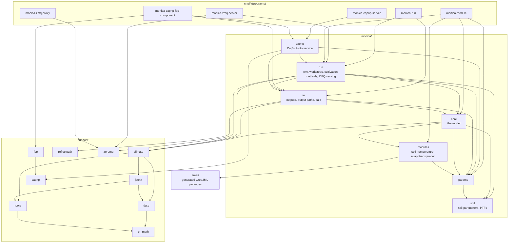
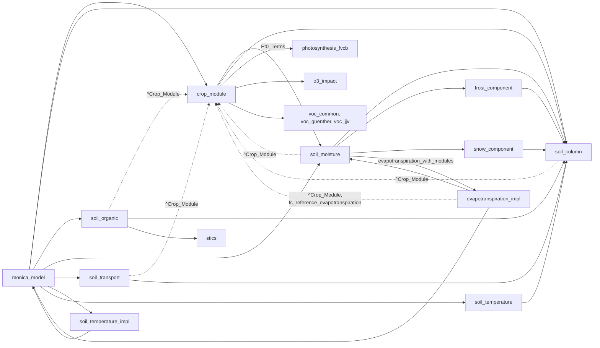
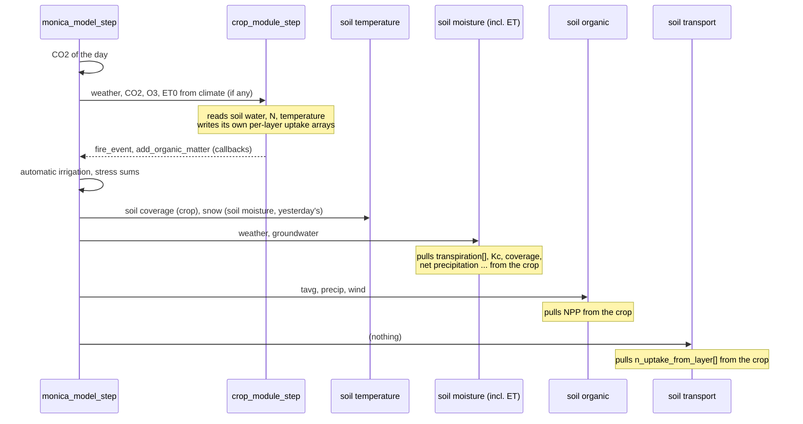
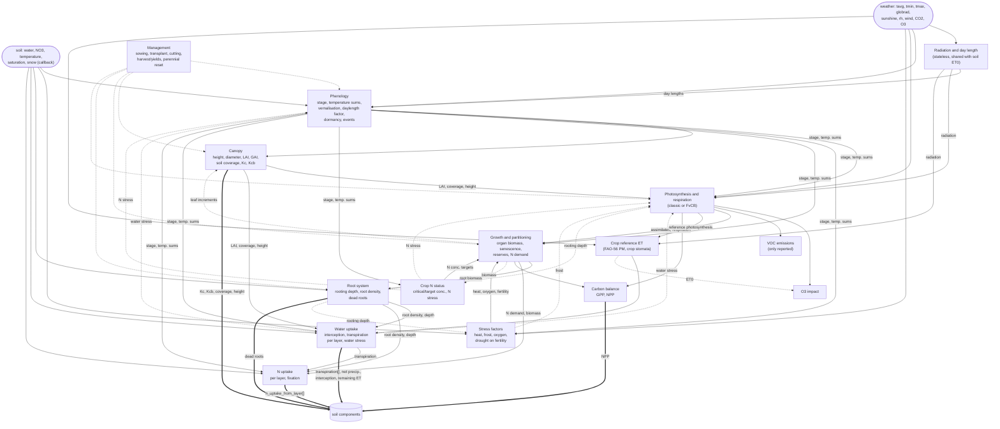

# The Odin MONICA's structure: dependencies, and how the crop module could be split

A map of what depends on what in the Odin MONICA (as of `ac1002f1`), and an
analysis of `monica/core/crop_module.odin`: which single-purpose components it
consists of, which data flows between them, and what stands in the way of
making them separate. The numbers come from scanning the code (imports,
references between files, and for the crop module which `Crop_Module` fields
each procedure reads and writes); the conclusions were checked by hand.

Nothing here changes the code. It is a basis for deciding where MONICA's
interfaces should be. Sections 7-9 look at the other modules and sketch the
two new structs the plan needs (previous-day values, crop-soil exchange).

The scans can be repeated with `tools/field_deps.py` (run from `odin/`):

    pixi run python tools/field_deps.py files monica/core
    pixi run python tools/field_deps.py fields monica/core/crop_module.odin Crop_Module cm
    pixi run python tools/field_deps.py lag monica/core/crop_module.odin Crop_Module cm crop_module_step
    pixi run python tools/field_deps.py fields monica/core/soil_moisture.odin Soil_Moisture sm --soil sm.soil_column

`files`: which file uses which other file's declarations; `fields`: per
procedure the struct's fields written and read (including those of the
procedures it calls), soil values read, procedures called; `lag`: the fields
the step reads before they are written that day - the previous day's values.
It is a text scan, not a parser: check what matters by hand.

## 1. Packages



(Edges to `support/date`, `tools`, `jsonx` and `cr_math` from most packages
left out.) The package level is clean: no cycles, and the layers are clear -
programs → `run`/`capnp` → `io` → `core` → `modules` → `amei`, with `params`
and `soil` below `core`. `monica/trace` is unused.

**The problem is inside `core`**: one package with 17 files, among them
`crop_module.odin` (4116 lines, 72 procedures, 172 fields in `Crop_Module`).
Package boundaries don't say anything about the model's structure.

## 2. Inside `core`

References between the files of `core` (an arrow: uses a declaration of; the
number: how many references):



The dotted arrows close cycles: the crop module reads the soil column, and
four soil components hold a `^Crop_Module` and read crop fields themselves.
The crop module also reaches back into the model through three callbacks that
`monica_model.odin` implements over a package-global `g_current_model`:

| Callback | Implemented by | Used in |
|---|---|---|
| `fire_event(name)` | `current_events[name] = true` | `crop_module_step` (emergence, anthesis, maturity, stages, stem elongation) |
| `add_organic_matter(layer → amount, N conc.)` | `soil_organic_add_organic_matter` | dead roots (`fc_move_dead_root_biomass_to_soil`), `apply_cutting` |
| `get_snow_depth_and_calc_temp_under_snow(tavg)` | `soil_moisture`'s snow component | `fc_frost_kill` |

### The crop ↔ soil interface today

Good news: the crop never writes into the soil column's layers directly. Water
and nitrogen uptake are written into the crop's own per-layer arrays, and the
soil components pull them. So the interface is already *narrow* - it is only
not *declared*: it consists of whatever fields the other side happens to read.

| Direction | Reader | Fields |
|---|---|---|
| crop → soil moisture | `soil_moisture.odin` | `transpiration[]`, `soil_coverage`, `kc_factor`, `kcb_factor`, `developmental_stage`, `net_precipitation`, `evaporated_from_intercept`, `remaining_evapotranspiration`, `reference_evapotranspiration`, `rooting_depth`, `crop_height` |
| crop → soil transport | `soil_transport.odin` | `n_uptake_from_layer[]` |
| crop → soil organic | `soil_organic.odin` | `net_primary_production`, plus dead roots and residues through `add_organic_matter` |
| crop → soil column | `soil_column.odin` (automatic irrigation) | `current_total_temperature_sum`, the cultivar's `heat_sum_irrigation_start/_end` |
| crop → soil temperature modules | `soil_temperature_impl.odin` | `leaf_area_index`, `crop_height`, `aboveground_biomass` |
| crop → ET modules | `evapotranspiration_impl.odin` | `transpiration`, `remaining_evapotranspiration`, `evaporated_from_intercept`, `gross_photosynthesis_reference_mol`, species' `carboxylation_pathway`, and it *calls* `fc_reference_evapotranspiration` on a copy of the crop |
| crop → model | `monica_model.odin` | `crop_n_redux`, `transpiration_deficit`, `crop_heat_redux`, `oxygen_deficit` (stress sums), `soil_coverage` (soil temperature), crop params (N-min fertilising) |
| soil → crop | `crop_module.odin` | per layer: `soil_moisture_m3`, `field_capacity`, `permanent_wilting_point`, `saturation`, `soil_no3`, `soil_temperature`, `layer_thickness_m`, `soil_clay_content`, `soil_sand_content`; column: `surface_water_storage`, `soil_surface_temperature`, `groundwater_table_layer_idx`, `number_of_organic_layers`; snow via callback |

Outside `core`, the outputs read the crop too: `io/build_output.odin` through
about 15 getters (`get_primary_crop_yield`, ...), and `io/output_paths.odin`
names 53 crop fields as output paths. With reflective outputs *every* field
name of `Crop_Module` is effectively public (`crop.<field>` paths) - which
matters for any restructuring (section 6).

## 3. A day



The crop runs first, on the soil state of the end of yesterday; the soil
components then use the crop's results of today.

## 4. The crop module: what it consists of

`crop_module_step` calls, in this order (procedure, lines):

| # | Procedure | Lines | Writes (main fields) | Reads from other parts |
|---|---|---:|---|---|
| 0 | (step: transplant shock, cutting delay) | - | `transplant_efficiency`, `days_since_transplant` | |
| 1 | `fc_radiation` | 84 | `declination`, day lengths, extraterrestrial/clear/overcast radiation, PAR | latitude only |
| 2 | `fc_oxygen_deficiency` | 39 | `oxygen_deficit`, `time_under_anoxia` | soil saturation & moisture, rooting depth |
| 3 | `fc_crop_developmental_stage` | 184 | `developmental_stage`, temperature sums, `growth_cycle_ended`; may reset `crop_params` (perennial) | soil temperature, top-layer moisture, surface water; *yesterday's* water/N stress, daylength & vernalisation factors |
| 4 | (step: events) | - | `anthesis_day`, `maturity_day`, ... | `fire_event` |
| 5 | `fc_daylength_factor`, `fc_vernalisation_factor` | 29 + 63 | `daylength_factor`, `vernalisation_factor`, `vernalisation_days` | day lengths |
| 6 | `fc_kc_factor` + the inline dual-Kc block | 20 + 70 | `kc_factor`, `kcb_factor` | temperature sums |
| 7 | `fc_crop_size`, `fc_crop_green_area`, `fc_soil_coverage` | 39 + 50 + 3 | `crop_height`, `crop_diameter`, `leaf_area_index`, `green_area_index`, `soil_coverage` | *yesterday's* leaf growth/senescence increments |
| 8 | `fc_crop_photosynthesis` | **716** | assimilates, gross photosynthesis, respiration, `gross_photosynthesis_reference_mol`, sunlit/shaded LAI, O3 damage, VOC buffers and emissions | radiation, LAI, CO2, O3; *yesterday's* water, N and frost stress, ET0, rooting depth, green organ biomass; root-zone soil moisture |
| 9 | `fc_heat_stress_impact` | 60 | `crop_heat_redux`, `total_crop_heat_impact` | |
| 10 | `fc_frost_kill` | 60 | `lt50`, `crop_frost_redux` | soil (surface) temperature, snow callback |
| 11 | `fc_drought_impact_on_fertility` | 26 | `drought_impact_on_fertility`; **clamps `transpiration_deficit`** | oxygen deficit |
| 12 | `fc_crop_nitrogen` | 47 | critical/target N concentration, `crop_n_redux`, `root_n_redux` | *yesterday's* biomass and N concentrations |
| 13 | `fc_crop_dry_matter` | **383** | organ biomass (green, dead, increments), totals, reserve pool, N demand, **and the root system**: rooting depth/zone, root density/diameter, total root length; dead roots to the soil | assimilates, all stress factors, soil water & clay |
| 14 | `fc_reference_evapotranspiration` | 109 | `stomata_resistance`, (ET0) | radiation, `gross_photosynthesis_reference_mol` (from 8) |
| 15 | `fc_crop_water_uptake` | 242 | interception, potential/actual transpiration, per-layer `transpiration[]`, `transpiration_deficit`, `net_precipitation`, `remaining_evapotranspiration` | Kc, coverage, height, root density, soil water |
| 16 | `fc_crop_n_uptake` | 192 | per-layer `n_uptake_from_layer[]`, N fixation, N contents | N demand, biomass, root density, soil NO3 & water, transpiration |
| 17 | `fc_gross/net_primary_production` | 4 + 5 | `gross_primary_production`, `net_primary_production` | |

Plus, outside the daily step: construction (`make_crop_module`, 150 lines,
and the parameter cloning), management (`force_transplant_state`,
`apply_cutting`, `set_perennial_crop_parameters`, `set_stage`), intercropping
(`crop_module_ic_send_rcv`, `set_other_crop_height_and_lait`), and about 20
read-only getters for yields, N contents and respiration.

### Previous-day feedbacks

Reads of a field that is written only *later* in the step - i.e. yesterday's
value is used. These are the real loops between the components:

| Reader | Yesterday's | Writer |
|---|---|---|
| development (3) | `transpiration_deficit` | water uptake (15) |
| development (3) | `crop_n_redux` | crop nitrogen (12) |
| development (3) | `daylength_factor`, `vernalisation_factor` | (5) - computed *after* the stage today |
| canopy (7) | leaf growth & senescence increments | dry matter (13) |
| photosynthesis (8) | `transpiration_deficit`, `crop_n_redux`, `crop_frost_redux` | (15), (12), frost (10) |
| photosynthesis (8) | `reference_evapotranspiration` (O3 uptake), `rooting_depth` | ET0 (14), dry matter (13) |
| oxygen deficiency (2) | `rooting_depth` | dry matter (13) |
| crop nitrogen (12) | biomass and N concentrations | dry matter (13), N uptake (16) |

That development uses yesterday's daylength and vernalisation factors is
probably not intended, but it is what the C++ does; a restructuring has to
keep it (CI compares with the C++ value by value) and can at least make it
visible.

### Hidden couplings

Things a split has to deal with, because one part changes another part's data:

1. **Everything takes `^Crop_Module`.** Only 6 of the 17 step procedures
   return their result; the others write fields. A procedure's signature says
   nothing about what it needs or produces - the tables above had to be
   recovered by scanning the bodies.
2. **`fc_drought_impact_on_fertility` clamps `transpiration_deficit`** (to
   ≥ 0), the water uptake's output.
3. **Parameters as state.** `apply_cutting` multiplies the cultivar's
   `max_assimilation_rate`; the perennial reset in
   `fc_crop_developmental_stage` replaces all of `crop_params` mid-step (which
   is why the step reads parameters only through pointers).
4. **Management writes everywhere.** `force_transplant_state` sets
   phenology, canopy, biomass, roots and N state in one go; `apply_cutting`
   biomass, LAI, stage and parameters; `set_stage` is also called from the
   outputs (`io`'s settable "Stage").
5. **The root system lives inside `fc_crop_dry_matter`** (from about line
   2620 on) although it is a separate process with its own state, and is
   needed by oxygen deficiency, photosynthesis, water and N uptake.
6. **ET0 is crop-specific and needs photosynthesis.**
   `fc_reference_evapotranspiration` uses the stomata resistance derived from
   `gross_photosynthesis_reference_mol` (from 8), and
   `evapotranspiration_impl.odin` calls it on a copy of the crop to get the
   ET0 terms - a sign it wants to be a component of its own.
7. **Radiation is duplicated.** `soil_moisture.odin`'s ET0 (around line
   1168) computes declination and the day lengths again, with the same
   formulas as `fc_radiation`.
8. **Callbacks through a global** (`g_current_model`), see section 2.

## 5. Proposed components

Grouping the procedures by the state they own and the data they exchange gives
these components (bold arrows: same day; dashed: yesterday's value):



| Component | From today's code | State it would own | Size now | How separable |
|---|---|---|---:|---|
| Radiation and day length | `fc_radiation`; duplicate in `soil_moisture` | none | 84 | easy - pure function of day, latitude, radiation, sunshine |
| Phenology | `fc_crop_developmental_stage`, `fc_daylength_factor`, `fc_vernalisation_factor`, `set_stage`, anthesis/maturity, dormancy and events from the step, `wang_engel_temperature_response`, temperature-sum getters | stage, temperature sums, vernalisation days, dormancy end, events | ~400 | medium - needs explicit yesterday's stresses; the perennial reset |
| Canopy | `fc_crop_size`, `fc_crop_green_area`, `fc_soil_coverage`, `fc_kc_factor`, the dual-Kc block | height, diameter, LAI, GAI, Kc, Kcb | ~180 | easy |
| Photosynthesis and respiration | `fc_crop_photosynthesis` without O3 and VOC | the 24/240-step buffers (if not VOC-only) | ~550 | medium - the biggest procedure, but one purpose; FvCB is already in its own file |
| O3 impact | the O3 part of 8, `o3_impact.odin` | `o3_*` | (in 8) | easy, already half out |
| VOC emissions | `calculate_voc_emissions`, the buffer part of 8, `voc_*.odin` | rad/tfol buffers, emissions | (in 8) | easy - nothing in the model reads the results, only outputs: a natural *driver* |
| Stress factors | `fc_heat_stress_impact`, `fc_frost_kill`, `fc_oxygen_deficiency`, `fc_drought_impact_on_fertility` | lt50, time under anoxia, heat sums | ~190 | easy, each its own function |
| Crop N status | `fc_crop_nitrogen` | the "old" concentrations | 47 | easy |
| Growth and partitioning | first part of `fc_crop_dry_matter` | organ biomass arrays, reserves, totals | ~260 | medium |
| Root system | second part of `fc_crop_dry_matter`, `calc_root_density_factor_and_sum`, `fc_move_dead_root_biomass_to_soil`, `get_effective_rooting_depth` | rooting depth/zone, root density, diameter, length | ~180 | medium - must be cut out of the dry-matter procedure |
| Crop reference ET | `fc_reference_evapotranspiration` | stomata resistance | 109 | easy - and then shareable with `evapotranspiration_impl` |
| Water uptake | `fc_crop_water_uptake` | interception storage, per-layer transpiration | 242 | easy |
| N uptake | `fc_crop_n_uptake` | per-layer uptake, totals | 192 | easy |
| Carbon balance | GPP/NPP, respiration getters | | ~20 | trivial |
| Management | `make_crop_module`, `force_transplant_state`, `apply_cutting`, `set_perennial_crop_parameters`, yield and N-content getters | cut and exported biomass | ~500 | needs a "reset/apply to component" operation per component |

The soil side would see only two declared structs instead of a pointer to the
whole crop: what the crop gives the soil (`transpiration[]`,
`n_uptake_from_layer[]`, Kc, Kcb, coverage, height, net precipitation,
interception, remaining ET, rooting depth, NPP, development stage), and what
the soil gives the crop (the per-layer and column values of the table in
section 2). The soil components' `crop_module: ^Crop_Module` fields would go.

## 6. A way there, without changing a single result

Every step below is a pure restructuring: the same floating-point operations
in the same order, so the CI comparison with the C++ stays identical and
checks each step.

1. **Group the fields, keep the names working.** Split `Crop_Module` into
   sub-structs per component (`Phenology`, `Canopy`, `Root_System`, ...) and
   embed them with `using`: `cm.leaf_area_index` keeps compiling everywhere,
   and the grouping is visible in the type. Outputs: `reflectpath` doesn't
   look through `using` (that's why driver inputs need `input.daily.<field>`),
   so either it learns to flatten `using` fields or the old paths get aliases
   like the moved soil-organic ones.
2. **Narrow the signatures, leaves first.** Radiation, daylength and
   vernalisation factor, Kc, soil coverage, heat, frost, oxygen, crop N:
   each gets its inputs as parameters and returns (or writes into) its own
   sub-struct only. The compiler then checks the dependencies.
3. **Make the previous-day values explicit.** A small struct of yesterday's
   stresses (water, N, frost, rooting depth, leaf increments, ET0), filled at
   the end of the step and read by the next one. Bit-identical, but the
   feedback loops become visible (and the daylength/vernalisation ordering
   quirk becomes a documented line instead of an accident of order).
4. **Cut the two big procedures.** The root system out of
   `fc_crop_dry_matter`; O3 and VOC out of `fc_crop_photosynthesis`.
5. **Declare the crop ↔ soil exchange.** The two structs from section 5,
   filled by the crop step and read by the soil components; remove the soil
   components' `^Crop_Module`. The callbacks become values the step returns
   (events, organic matter to add) or explicit parameters (snow).
6. **Share what is duplicated.** One radiation and day-length function for
   the crop and the soil ET0, one crop ET0 used by the crop and by
   `evapotranspiration_impl`.
7. **Then swappable**, like soil temperature and evapotranspiration: a
   component with declared inputs and outputs fits the `Module_Entry`
   machinery (integrated / driver / standalone, `how-to-use.md`). VOC
   emissions are a driver already in all but name; phenology,
   photosynthesis and water uptake are the obvious next candidates for
   alternative models.

After the crop module, `soil_organic.odin` (1676 lines) and
`soil_moisture.odin` (1483 lines) would deserve the same analysis.

## 7. The other modules

The crop module is the clearest case, but not the only one. In order of
how much a split would gain:

**`soil_moisture.odin` (1483 lines).** Three things in one: the water balance
(infiltration, percolation with and without groundwater, capillary rise,
groundwater and backwater replenishment), evapotranspiration
(`reference_evapotranspiration` 164 lines, `dual_kc_precomputation` 160,
`evapotranspiration` 217 - a third of the file), and the snow and frost
components (already separate files). `soil_moisture_step` writes 35 fields.
Evapotranspiration is half out already (`evapotranspiration_impl.odin` and the
swappable modules): finishing that gives an evapotranspiration component of
its own, which shares ET0 with the crop's and the radiation and day length
with the crop (section 4, couplings 6 and 7). After that, soil moisture is
the water balance only.

**`soil_column.odin` (747 lines): shared state plus management.** It holds
`Soil_Layer` (31 fields), the soil state all components share, and the
management actions on it: automatic irrigation, tillage, N-min and N-demand
fertilising, delayed fertiliser, top dressing. Two steps:

- move the management actions out (together with the crop's management,
  section 5: one "management" component that worksteps and automatic rules
  act through);
- make the ownership of `Soil_Layer` explicit. The layers are a shared
  blackboard, which is fine for a soil model, but each value should have one
  writer during the day. Today: water content - soil moisture; temperature -
  soil temperature; `soil_frozen` - frost; NO3 - soil transport; NH4, urea,
  SOM/SMB pools - soil organic; and soil column itself for everything at
  initialisation and for management. Grouping the fields by owner (water,
  temperature, mineral N, organic pools, texture/hydraulic properties) would
  show that in the type, like the `using` grouping of section 6.

**`soil_organic.odin` (1676 lines): almost there.** It is already split into
per-process procedures, run in order by `soil_organic_step`: urea hydrolysis,
decomposition (`soil_organic_fo_mit`, 353 lines - the AOM/SOM/SMB pools),
volatilisation, nitrification, denitrification, N2O production, pool update;
the moisture and temperature response functions are small and pure. For
nitrification, denitrification and N2O there are already two models each
(MONICA's and STICS', chosen by `stics_params.use_nit/use_denit/use_n2o`) -
the swappable-module idea, written as `if`s. What's missing are declared
inputs and outputs: every procedure takes `^Soil_Organic` and reads and writes
the soil layers directly. The N transformations are the obvious first
candidates for real components; `soil_organic_add_organic_matter` (212 lines)
belongs with the management/residue side.

**`monica_model.odin` (961 lines).** Mostly orchestration, which is its job.
Two parts don't belong: harvest and incorporation of the crop
(`monica_model_harvest_current_crop`, 154 lines, plus incorporation) belong to
management; CO2, O3 and groundwater for the day (`co2_for_date`,
`groundwater_depth_for_date`, the selection in the step) are the day's
boundary conditions and could be one small component that gives the other
components their weather-like inputs. And the three callbacks over
`g_current_model` (section 2) would go with the exchange structs (section 9).

**Fine as they are:** `soil_transport.odin` (353 lines, one purpose: N
transport), `soil_temperature.odin` (already swappable), `snow_component`,
`frost_component`, `photosynthesis_fvcb.odin`, `o3_impact.odin`, the VOC
files. Outside `core`, `io` and `run` are large but organised by purpose
(output definitions, worksteps); they would only follow the renames.

## 8. Previous-day values: a carry-over struct

The idea is the same as Crop2ML's `s1`, but narrower.

**What Crop2ML does.** A Crop2ML model gets its state twice: `s1`, the state
at the end of the previous day, which it reads, and `s`, the state of today,
which it writes. The host copies `s` to `s1` between the days. (In practice
the packages we use don't read `s1` at all - `s1.` appears nowhere in
`amei/` - they update `s` in place, and `s1` is only passed along.) Values
another model computes are exogenous inputs; in a composite model, a link
whose source runs *after* its target that day delivers yesterday's value.

**Why not `s`/`s1` for the whole crop.** Copying all 172 fields every day
would work, but would hide what matters: the crop has about a dozen values
that cross from one component to another with a day's delay (section 4).
Most of the rest is a component's own state, updated in place (temperature
sums, organ biomass), and some fields are read the *same* day after they are
written, deliberately. A full `s1` doesn't say which is which.

**What I'd do.** A small struct with exactly the delayed links, and each
component gets it as an explicit input:

```odin
// The values today's components read from yesterday, because the component
// computing them runs later in the step (architecture.md, section 4).
Crop_Carry_Over :: struct {
	water_stress:              f64 `unit:"0-1"`,       // transpiration_deficit, from water uptake
	n_stress:                  f64 `unit:"0-1"`,       // crop_n_redux, from crop N status
	frost_redux:               f64 `unit:"0-1"`,       // crop_frost_redux, from frost
	daylength_factor:          f64 `unit:"0-1"`,       // from phenology, computed after the stage
	vernalisation_factor:      f64 `unit:"0-1"`,
	rooting_depth:             int `unit:"layer#"`, // from the root system
	leaf_growth_increment:     f64 `unit:"kgDM ha-1"`, // from growth
	leaf_senescence_increment: f64 `unit:"kgDM ha-1"`,
	reference_et0:             f64 `unit:"mm"`,      // for the O3 uptake
	// ... biomass and N concentrations for crop N status, crop height
	// for intercropping (the full list: `field_deps.py lag`)
}

crop_module_step :: proc(cm: ^Crop_Module, ...) {
	prev := carry_over_of(cm) // taken at the START of the day
	...
	fc_crop_developmental_stage(&cm.phenology, prev.water_stress, prev.n_stress,
		prev.daylength_factor, prev.vernalisation_factor, ...)
	...
}
```

Two details make this bit-identical to today:

- **Take it at the start of the step, not at the end of the previous one.**
  Between two crop steps, management changes the crop (cutting reduces
  biomass and LAI, `set_stage` from the outputs, transplanting), and today's
  code sees those changes. A snapshot taken at the start of the day is
  exactly what the components read today, because they read before the
  writer runs - so the results can't change, and the compiler then shows
  every place that uses a delayed value.
- **Make in-between corrections explicit.** `fc_drought_impact_on_fertility`
  clamps the water stress to ≥ 0 before growth reads it. With the carry-over
  that becomes a line in the step (`water_stress := max(prev.water_stress, 0)`)
  instead of a write into the water uptake's field.

Later, if a component becomes a swappable module (`Module_Entry`), its
carry-over values are simply part of its inputs, as exogenous inputs are for
a Crop2ML model, and the carry-over struct is the wiring of the delayed links
in MONICA's composite. A module that needs its *own* previous state can still
have an `s1`.

## 9. The crop-soil exchange structs

Today the soil components hold a `^Crop_Module` and read what they need
(section 2). The idea: the crop step fills a declared struct with what it
gives the soil, and the soil components get that struct instead of the
crop. Names stay those of the crop's fields, so output paths can stay
readable.

```odin
// What the crop gives the soil components each day; filled at the end of
// crop_module_step, owned by Monica_Model.
Crop_To_Soil :: struct {
	present:                       bool, // a crop that isn't being cleared
	developmental_stage:           int,
	// canopy - soil moisture, soil temperature
	soil_coverage:                 f64, // fraction (no unit tag yet)
	kc_factor, kcb_factor:         f64 `unit:"1"`,
	crop_height:                   f64 `unit:"m"`,
	leaf_area_index:               f64 `unit:"m2 m-2"`,
	aboveground_biomass:           f64 `unit:"kgDM ha-1"`,
	// water - soil moisture
	reference_evapotranspiration:  f64 `unit:"mm"`,
	remaining_evapotranspiration:  f64 `unit:"mm"`,
	net_precipitation:             f64, // (no unit tag yet)
	evaporated_from_intercept:     f64 `unit:"mm"`,
	rooting_depth:                 int `unit:"layer#"`,
	transpiration:                 []f64 `unit:"mm"`, // per layer
	// nitrogen - soil transport
	n_uptake_from_layer:           []f64, // per layer (no unit tag yet)
	// carbon - soil organic
	net_primary_production:        f64 `unit:"kgC ha-1"`,
	// automatic irrigation - soil column
	current_total_temperature_sum: f64 `unit:"°C d"`,
	heat_sum_irrigation_start:     f64 `unit:"°C d"`,
	heat_sum_irrigation_end:       f64 `unit:"°C d"`,
}

// What the crop step hands back instead of calling into the model
Crop_Day_Results :: struct {
	events:         [dynamic]string,        // emergence, anthesis, Stage-n, ...
	organic_matter: [dynamic]Om_Addition,   // dead roots, cut residues: layer -> amount, N conc.
}
```

And the use in the model's day:

```odin
monica_model_step :: proc(model: ^Monica_Model, ...) {
	model.crop_to_soil = {} // bare soil: every reader gets the same defaults
	if model.current_crop_module != nil && !model.clear_crop_upon_next_day {
		results := crop_module_step(model.current_crop_module, ..., &model.crop_to_soil)
		apply_crop_day_results(model, results) // events, organic matter
	}
	...
	soil_moisture_step(&model.soil_moisture, &model.crop_to_soil, ...)
	soil_organic_step(&model.soil_organic, &model.crop_to_soil, ...)
	soil_transport_step(&model.soil_transport, &model.crop_to_soil)
}
```

What it gains:

- **The interface is in one place, with units.** Today it is spread over
  ~25 reads in six files, each with its own `if crop_module != nil` and its
  own default for bare soil; `present = false` and zero values would replace
  them (checking that each reader's default really was 0).
- **The soil components no longer depend on the crop module.** They can be
  tested, run standalone, or swapped with only a `Crop_To_Soil` (from a file,
  like `monica-module` does now), and a different crop model only has to fill
  this struct. The `Input` structs of the soil temperature and
  evapotranspiration modules are the same pattern already: `gather` in
  `soil_temperature_impl.odin`/`evapotranspiration_impl.odin` fills them from
  the soil column and the crop.
- **No callbacks over a global.** Events and organic matter come back as
  values and the model applies them; the snow depth for frost kill becomes a
  parameter of the crop step (soil moisture's snow component from yesterday,
  as now).
- **Room for two crops.** With intercropping, two crops could each fill one,
  and the model combine them (transpiration and N uptake per layer).

Details to check when doing it, to stay bit-identical:

- **When organic matter is added.** Today `add_organic_matter` runs *during*
  the crop step. Applying it after the step is the same only if nothing the
  crop reads later that day depends on it; the dead roots go into soil
  organic's pools, which the crop doesn't read, but that needs checking per
  call (and for `apply_cutting`, which isn't part of the step anyway).
- **Copies or views.** The per-layer slices can point to the crop's arrays
  (no copy) or be copied (20 values); a view is simplest, but then the
  struct is only valid until the crop is removed - the model owns both, so
  that is manageable.
- **The other direction.** The crop reads about 13 soil values (section 2).
  The soil column is the shared state of the soil, so reading it is
  legitimate; a `Soil_To_Crop` struct would mainly document *which* values the
  crop reads. I'd start with `Crop_To_Soil`, which removes the cycle, and
  replace the crop's `^Soil_Column` with a read view only once the crop's
  components (section 5) have explicit inputs anyway.
