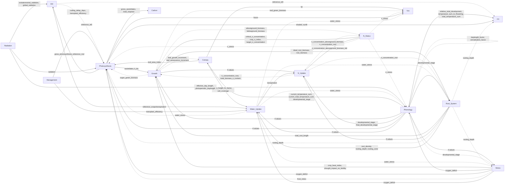

<!-- generated by `pixi run python tools/component_check.py doc` - don't edit -->
# The crop components

Generated from the state structs and the tagged inputs in `monica/core/crop_*.odin`
(`CONVENTIONS.md` 9b, `plan-component-interfaces.md`). Solid arrows: the same day's value;
dashed: the previous day's (`lag:"1d"`, from `Crop_Carry_Over`, or read in place before
the source runs). Same-day edges from a component to itself are left out; the inputs from the
weather, the soil, the site and the parameters are in the tables. What the crop gives the soil
is `Crop_To_Soil` (`crop_to_soil.odin`).

## Radiation

`monica/core/crop_radiation.odin`

State `Crop_Radiation`:

| Field | Type | Unit |
|---|---|---|
| `declination` | `f64` | ° |
| `astronomic_day_lenght` | `f64` | h |
| `effective_day_length` | `f64` | h |
| `photoperiodic_daylength` | `f64` | h |
| `extraterrestrial_radiation` | `f64` | MJ m-2 |
| `clear_day_radiation` | `f64` | J m-2 |
| `overcast_day_radiation` | `f64` | J m-2 |
| `phot_act_radiation_mean` | `f64` | J m-2 |
| `global_radiation` | `f64` | MJ m-2 |

Input `Radiation_In`:

| Field | Type | Unit | From | Previous day | Note |
|---|---|---|---|---|---|
| `julian_day` | `f64` | d |  |  |  |
| `latitude` | `f64` | ° | site |  |  |
| `global_radiation` | `f64` | MJ m-2 | weather |  |  |
| `sunshine_hours` | `f64` | h | weather |  |  |

## Phenology

`monica/core/crop_phenology.odin`

State `Crop_Phenology`:

| Field | Type | Unit |
|---|---|---|
| `developmental_stage` | `int` |  |
| `final_developmental_stage` | `int` |  |
| `current_temperature_sum` | `[dynamic]f64` | °C d |
| `current_total_temperature_sum` | `f64` | °C d |
| `total_temperature_sum` | `f64` | °C d |
| `temperature_sum_to_flowering` | `f64` | °C d |
| `relative_total_development` | `f64` | 0-1 |
| `daylength_factor` | `f64` | 0-1 |
| `vernalisation_factor` | `f64` | 0-1 |
| `vernalisation_days` | `f64` | d |
| `growth_cycle_ended` | `bool` |  |
| `perennial_crop_dormancy_period_end_date` | `d.Date` |  |
| `no_of_crop_steps` | `int` | d |
| `stem_elongation_event_fired` | `bool` |  |
| `anthesis_day` | `int` |  |
| `maturity_day` | `int` |  |
| `maturity_reached` | `bool` |  |
| `time_step` | `f64` | d |

Input `Daylength_Factor_In`:

| Field | Type | Unit | From | Previous day | Note |
|---|---|---|---|---|---|
| `daylength_requirement` | `f64` | h | cultivar |  |  |
| `base_daylength` | `f64` | h | cultivar |  |  |
| `effective_day_length` | `f64` | h | Radiation |  |  |
| `photoperiodic_daylength` | `f64` | h | Radiation |  |  |

Input `Phenology_Events_In`:

| Field | Type | Unit | From | Previous day | Note |
|---|---|---|---|---|---|
| `old_developmental_stage` | `int` |  |  |  | before today's development |
| `julian_day` | `int` | d |  |  |  |
| `no_of_dev_stages` | `int` |  | crop parameters |  |  |

Input `Phenology_In`:

| Field | Type | Unit | From | Previous day | Note |
|---|---|---|---|---|---|
| `mean_air_temperature` | `f64` | °C | weather |  |  |
| `current_date` | `d.Date` |  |  |  |  |
| `soil_temperature_top` | `f64` | °C | soil |  | layer 0 |
| `soil_moisture_top` | `f64` | m3 m-3 | soil |  |  |
| `field_capacity_top` | `f64` | m3 m-3 | soil |  |  |
| `permanent_wilting_point_top` | `f64` | m3 m-3 | soil |  |  |
| `surface_water_storage` | `f64` | mm | soil |  |  |
| `water_stress` | `f64` | 0-1 | Water_Uptake | yes |  |
| `n_stress` | `f64` | 0-1 | N_Status | yes |  |
| `daylength_factor` | `f64` | 0-1 | Phenology | yes |  |
| `vernalisation_factor` | `f64` | 0-1 | Phenology | yes |  |
| `oxygen_deficit` | `f64` | 0-1 | Stress |  |  |
| `storage_organ` | `int` |  | crop parameters |  |  |
| `no_of_dev_stages` | `int` |  | crop parameters |  |  |
| `time_step` | `f64` | d |  |  |  |
| `emergence_moisture_control_on` | `bool` |  | simulation parameters |  |  |
| `emergence_flooding_control_on` | `bool` |  | simulation parameters |  |  |
| `enable_wang_engel_temperature_response` | `bool` |  | crop module parameters |  |  |

Input `Vernalisation_In`:

| Field | Type | Unit | From | Previous day | Note |
|---|---|---|---|---|---|
| `mean_air_temperature` | `f64` | °C | weather |  |  |
| `vernalisation_requirement` | `f64` | d | cultivar |  |  |
| `vernalisation_days` | `f64` | d | Phenology |  | so far |
| `time_step` | `f64` | d |  |  |  |
| `enable_fix` | `bool` |  | crop parameters |  | vernalisation_factor_fix_enabled |

## Canopy

`monica/core/crop_canopy.odin`

State `Crop_Canopy`:

| Field | Type | Unit |
|---|---|---|
| `crop_height` | `f64` | m |
| `crop_diameter` | `f64` | m |
| `leaf_area_index` | `f64` | m2 m-2 |
| `green_area_index` | `f64` | m2 m-2 |
| `soil_coverage` | `f64` | 0-1 |
| `kc_factor` | `f64` | 1 |
| `kcb_factor` | `f64` | 1 |
| `kcb_ini` | `f64` | 1 |
| `kcb_mid` | `f64` | 1 |
| `kcb_end` | `f64` | 1 |

Input `Canopy_Growth_In`:

| Field | Type | Unit | From | Previous day | Note |
|---|---|---|---|---|---|
| `developmental_stage` | `int` |  | Phenology |  |  |
| `mean_air_temperature` | `f64` | °C | weather |  |  |
| `max_crop_height` | `f64` | m |  |  |  |
| `current_total_temperature_sum` | `f64` | °C d | Phenology |  |  |
| `current_temperature_sum` | `[]f64` | °C d | Phenology |  | per stage |
| `leaf_growth_increment` | `f64` | kgDM ha-1 | Growth | yes |  |
| `leaf_senescence_increment` | `f64` | kgDM ha-1 | Growth | yes |  |
| `enable_t_response_leaf_expansion` | `bool` |  | crop module parameters |  |  |
| `time_step` | `f64` | d |  |  |  |

Input `Canopy_Kc_In`:

| Field | Type | Unit | From | Previous day | Note |
|---|---|---|---|---|---|
| `developmental_stage` | `int` |  | Phenology |  |  |
| `current_temperature_sum` | `[]f64` | °C d | Phenology |  | per stage |
| `bare_soil_kc_factor` | `f64` | 1 | site |  |  |

## Photosynthesis

`monica/core/crop_photosynthesis.odin`

State `Crop_Photosynthesis`:

| Field | Type | Unit |
|---|---|---|
| `co2_method` | `int` |  |
| `assimilation_rate` | `f64` | kg CO2 ha-1 h-1 |
| `gross_photosynthesis` | `f64` | kgCH2O ha-1 |
| `gross_photosynthesis_mol` | `f64` | mol m-2 s-1 |
| `gross_photosynthesis_reference_mol` | `f64` | mol m-2 s-1 |
| `gross_assimilates` | `f64` | kgCH2O ha-1 |
| `assimilates` | `f64` | kgCH2O ha-1 |
| `growth_respiration_as` | `f64` | kgCH2O ha-1 |
| `maintenance_respiration_as` | `f64` | kgCH2O ha-1 |
| `net_maintenance_respiration` | `f64` | kgCH2O ha-1 |
| `total_respired` | `f64` | kgCH2O ha-1 |
| `sunlit_leaf_area_index` | `[dynamic]f64` | m2 m-2 |
| `shaded_leaf_area_index` | `[dynamic]f64` | m2 m-2 |
| `k_tkc` | `f64` | 1 |
| `k_tko` | `f64` | 1 |
| `fraction_of_intercepted_radiation1` | `f64` | 0-1 |
| `fraction_of_intercepted_radiation2` | `f64` | 0-1 |
| `max_assimilation_rate` | `f64` | kg CO2 ha-1 h-1 |

Input `Photosynthesis_In`:

| Field | Type | Unit | From | Previous day | Note |
|---|---|---|---|---|---|
| `mean_air_temperature` | `f64` | °C | weather |  |  |
| `max_air_temperature` | `f64` | °C | weather |  |  |
| `min_air_temperature` | `f64` | °C | weather |  |  |
| `atmospheric_co2_concentration` | `f64` | ppm | weather |  |  |
| `atmospheric_o3_concentration` | `f64` | ppb | weather |  |  |
| `current_date` | `d.Date` |  |  |  |  |
| `latitude` | `f64` | ° | site |  |  |
| `radiation` | `Crop_Radiation` |  | Radiation |  | today's |
| `water_stress` | `f64` | 0-1 | Water_Uptake | yes |  |
| `n_stress` | `f64` | 0-1 | N_Status | yes |  |
| `frost_redux` | `f64` | 0-1 | Stress | yes |  |
| `rooting_depth` | `int` | layer# | Root_System | yes |  |
| `reference_et0` | `f64` | mm | Et0 | yes |  |
| `organ_green_biomass` | `[]f64` | kgDM ha-1 | Growth | yes | per organ |
| `developmental_stage` | `int` |  | Phenology |  |  |
| `relative_total_development` | `f64` | 0-1 | Phenology |  |  |
| `temperature_sum_to_flowering` | `f64` | °C d | Phenology |  |  |
| `total_temperature_sum` | `f64` | °C d | Phenology |  |  |
| `leaf_area_index` | `f64` | m2 m-2 | Canopy |  |  |
| `oxygen_deficit` | `f64` | 0-1 | Stress |  |  |
| `cutting_delay_days` | `int` | d | Management |  |  |
| `transplant_efficiency` | `f64` | 0-1 | Management |  |  |
| `no_of_organs` | `int` |  | crop parameters |  |  |
| `water_deficit_response_on` | `bool` |  | simulation parameters |  |  |
| `soil_layers` | `[]Soil_Layer` |  | soil |  | for the O3 uptake |

## O3

`monica/core/crop_o3.odin`

State `Crop_O3`:

| Field | Type | Unit |
|---|---|---|
| `o3_short_term_damage` | `f64` | 0-1 |
| `o3_long_term_damage` | `f64` | 0-1 |
| `o3_senescence` | `f64` | 0-1 |
| `o3_sum_uptake` | `f64` | µmol m-2 |
| `o3_w_stomatal_closure` | `f64` | 0-1 |

Input `O3_Hourly_In`:

| Field | Type | Unit | From | Previous day | Note |
|---|---|---|---|---|---|
| `hour` | `int` | h |  |  |  |
| `sunlit` | `Fvcb_Leaf_Fraction` |  | Photosynthesis |  |  |
| `shaded` | `Fvcb_Leaf_Fraction` |  | Photosynthesis |  |  |
| `rooting_depth` | `int` | layer# | Root_System | yes |  |
| `soil_layers` | `[]Soil_Layer` |  | soil |  | FC, PWP, soil moisture in the rooted zone |
| `reference_et0` | `f64` | mm | Et0 | yes |  |
| `atmospheric_o3_concentration` | `f64` | ppb | weather |  |  |
| `relative_total_development` | `f64` | 0-1 | Phenology |  |  |
| `temperature_sum_to_flowering` | `f64` | °C d | Phenology |  |  |
| `total_temperature_sum` | `f64` | °C d | Phenology |  |  |
| `water_deficit_response_on` | `bool` |  | simulation parameters |  |  |

## Voc

`monica/core/crop_voc.odin`

State `Crop_Voc`:

| Field | Type | Unit |
|---|---|---|
| `step_size24` | `int` |  |
| `step_size240` | `int` |  |
| `rad24` | `[dynamic]f64` | W m-2 |
| `rad240` | `[dynamic]f64` | W m-2 |
| `tfol24` | `[dynamic]f64` | °C |
| `tfol240` | `[dynamic]f64` | °C |
| `index24` | `int` |  |
| `index240` | `int` |  |
| `full24` | `bool` |  |
| `full240` | `bool` |  |
| `guenther_emissions` | `Voc_Emissions` |  |
| `jjv_emissions` | `Voc_Emissions` |  |
| `voc_species` | `Voc_Species_Data` |  |
| `crop_photosynthesis_results` | `Voc_Cp_Data` |  |

Input `Voc_In`:

| Field | Type | Unit | From | Previous day | Note |
|---|---|---|---|---|---|
| `hours` | `[24]Voc_Hour` |  | Photosynthesis |  |  |
| `lai` | `f64` | m2 m-2 | Canopy |  |  |
| `leaf_green_biomass` | `f64` | kgDM ha-1 | Growth | yes |  |
| `specific_leaf_area` | `f64` | ha kg-1 | cultivar |  |  |
| `atmospheric_co2_concentration` | `f64` | ppm | weather |  |  |
| `n_stress` | `f64` | 0-1 | N_Status | yes |  |
| `water_stress` | `f64` | 0-1 | Water_Uptake | yes |  |

## Stress

`monica/core/crop_stress.odin`

State `Crop_Stress`:

| Field | Type | Unit |
|---|---|---|
| `oxygen_deficit` | `f64` | 0-1 |
| `time_under_anoxia` | `int` | d |
| `time_under_anoxia_threshold_default` | `int` | d |
| `crop_heat_redux` | `f64` | 0-1 |
| `days_after_begin_flowering` | `int` | d |
| `total_crop_heat_impact` | `f64` | 0-1 |
| `crop_frost_redux` | `f64` | 0-1 |
| `lt50` | `f64` | °C |
| `lt50_m` | `f64` | °C |
| `drought_impact_on_fertility` | `f64` | 0-1 |

Input `Drought_Impact_In`:

| Field | Type | Unit | From | Previous day | Note |
|---|---|---|---|---|---|
| `water_stress` | `f64` | 0-1 | Water_Uptake | yes |  |
| `developmental_stage` | `int` |  | Phenology |  |  |
| `storage_organ` | `int` |  | crop parameters |  |  |

Input `Frost_Kill_In`:

| Field | Type | Unit | From | Previous day | Note |
|---|---|---|---|---|---|
| `max_air_temperature` | `f64` | °C | weather |  |  |
| `min_air_temperature` | `f64` | °C | weather |  |  |
| `snow` | `Snow_For_Crop` |  | soil moisture |  |  |
| `snow_depth_mm` | `f64` | mm | soil |  | for the respiratory stress |
| `soil_surface_temperature` | `f64` | °C | soil |  |  |
| `top_soil_temperature` | `f64` | °C | soil |  | layer 0 |
| `developmental_stage` | `int` |  | Phenology |  |  |
| `vernalisation_factor` | `f64` | 0-1 | Phenology |  |  |
| `current_temperature_sum` | `[]f64` | °C d | Phenology |  | per stage |

Input `Heat_Stress_In`:

| Field | Type | Unit | From | Previous day | Note |
|---|---|---|---|---|---|
| `max_air_temperature` | `f64` | °C | weather |  |  |
| `min_air_temperature` | `f64` | °C | weather |  |  |
| `current_total_temperature_sum` | `f64` | °C d | Phenology |  |  |

Input `Oxygen_Deficiency_In`:

| Field | Type | Unit | From | Previous day | Note |
|---|---|---|---|---|---|
| `critical_oxygen_content` | `f64` | m3 m-3 | species | yes | at yesterday's stage |
| `developmental_stage` | `int` |  | Phenology | yes |  |
| `rooting_depth` | `int` | layer# | Root_System | yes |  |
| `time_under_anoxia_threshold` | `[]int` | d | crop module parameters |  | per stage |
| `time_step` | `f64` | d |  |  |  |
| `soil_layers` | `[]Soil_Layer` |  | soil |  | saturation, soil moisture |

## N_Status

`monica/core/crop_n_status.odin`

State `Crop_N_Status`:

| Field | Type | Unit |
|---|---|---|
| `critical_n_concentration` | `f64` | kgN kgDM-1 |
| `target_n_concentration` | `f64` | kgN kgDM-1 |
| `crop_n_redux` | `f64` | 0-1 |
| `root_n_redux` | `f64` | 0-1 |
| `n_concentration_aboveground_biomass_old` | `f64` | kgN kgDM-1 |
| `n_concentration_root_old` | `f64` | kgN kgDM-1 |

Input `N_Status_In`:

| Field | Type | Unit | From | Previous day | Note |
|---|---|---|---|---|---|
| `aboveground_biomass` | `f64` | kgDM ha-1 | Growth | yes |  |
| `belowground_biomass` | `f64` | kgDM ha-1 | Growth | yes |  |
| `n_concentration_aboveground_biomass` | `f64` | kgN kgDM-1 | N_Uptake | yes |  |
| `n_concentration_root` | `f64` | kgN kgDM-1 | N_Uptake | yes |  |
| `nitrogen_response_on` | `bool` |  | simulation parameters |  |  |

## Growth

`monica/core/crop_growth.odin`

State `Crop_Growth`:

| Field | Type | Unit |
|---|---|---|
| `organ_biomass` | `[dynamic]f64` | kgDM ha-1 |
| `organ_green_biomass` | `[dynamic]f64` | kgDM ha-1 |
| `organ_dead_biomass` | `[dynamic]f64` | kgDM ha-1 |
| `organ_growth_increment` | `[dynamic]f64` | kgDM ha-1 |
| `organ_senescence_increment` | `[dynamic]f64` | kgDM ha-1 |
| `aboveground_biomass` | `f64` | kgDM ha-1 |
| `aboveground_biomass_old` | `f64` | kgDM ha-1 |
| `belowground_biomass` | `f64` | kgDM ha-1 |
| `belowground_biomass_old` | `f64` | kgDM ha-1 |
| `total_biomass` | `f64` | kgDM ha-1 |
| `reserve_assimilate_pool` | `f64` | kgCH2O ha-1 |
| `net_photosynthesis` | `f64` | kgCH2O ha-1 |
| `crop_n_demand` | `f64` | kgN ha-1 |
| `max_n_uptake` | `f64` | kgN m-1 d-1 |
| `assimilate_part_coeffs_reduced` | `bool` |  |
| `dying_out` | `bool` |  |

Input `Growth_In`:

| Field | Type | Unit | From | Previous day | Note |
|---|---|---|---|---|---|
| `assimilates` | `f64` | kgCH2O ha-1 | Photosynthesis |  |  |
| `k_tkc` | `f64` | 1 | Photosynthesis |  |  |
| `crop_heat_redux` | `f64` | 0-1 | Stress |  |  |
| `drought_impact_on_fertility` | `f64` | 0-1 | Stress |  |  |
| `crop_n_redux` | `f64` | 0-1 | N_Status |  |  |
| `critical_n_concentration` | `f64` | kgN kgDM-1 | N_Status |  |  |
| `target_n_concentration` | `f64` | kgN kgDM-1 | N_Status |  |  |
| `developmental_stage` | `int` |  | Phenology |  |  |
| `current_temperature_sum` | `[]f64` | °C d | Phenology |  | per stage |
| `n_concentration_root` | `f64` | kgN kgDM-1 | N_Uptake | yes |  |
| `total_biomass_n_content` | `f64` | kgN ha-1 | N_Uptake | yes |  |
| `no_of_organs` | `int` |  | crop parameters |  |  |
| `storage_organ` | `int` |  | crop parameters |  | the organ index |
| `time_step` | `f64` | d |  |  |  |
| `max_crop_n_demand` | `f64` | kgN ha-1 | crop module parameters |  | per day |

Input `Growth_N_Limit_In`:

| Field | Type | Unit | From | Previous day | Note |
|---|---|---|---|---|---|
| `total_root_length` | `f64` | m m-2 | Root_System |  | today's |
| `current_total_temperature_sum` | `f64` | °C d | Phenology |  |  |
| `total_temperature_sum` | `f64` | °C d | Phenology |  |  |
| `time_step` | `f64` | d |  |  |  |

## Root_System

`monica/core/crop_root_system.odin`

State `Crop_Root_System`:

| Field | Type | Unit |
|---|---|---|
| `rooting_depth` | `int` | layer# |
| `rooting_depth_m` | `f64` | m |
| `rooting_zone` | `int` | layer# |
| `max_rooting_depth` | `f64` | m |
| `soil_specific_max_rooting_depth` | `f64` | m |
| `root_biomass` | `f64` | kgDM ha-1 |
| `root_biomass_old` | `f64` | kgDM ha-1 |
| `root_density` | `[dynamic]f64` | m m-3 |
| `root_diameter` | `[dynamic]f64` | m |
| `total_root_length` | `f64` | m m-2 |
| `current_total_temperature_sum_root` | `f64` | °C d |

Input `Root_System_In`:

| Field | Type | Unit | From | Previous day | Note |
|---|---|---|---|---|---|
| `root_biomass` | `f64` | kgDM ha-1 | Growth |  | today's root organ biomass |
| `dead_root_biomass` | `f64` | kgDM ha-1 | Growth |  | today's |
| `n_concentration_root` | `f64` | kgN kgDM-1 | N_Uptake | yes |  |
| `water_stress` | `f64` | 0-1 | Water_Uptake | yes |  |
| `developmental_stage` | `int` |  | Phenology |  |  |
| `no_of_dev_stages` | `int` |  | crop parameters |  |  |
| `mean_air_temperature` | `f64` | °C | weather |  |  |
| `soil_layers` | `[]Soil_Layer` |  | soil |  |  |
| `number_of_organic_layers` | `int` |  | soil |  |  |
| `impenetrable_layer_depth` | `f64` | m | site |  |  |
| `max_effective_rooting_depth` | `f64` | m | site |  |  |
| `enable_pasw_root_penetration` | `bool` |  | crop module parameters |  |  |
| `disable_daily_root_biomass_to_soil` | `bool` |  | crop module parameters |  |  |

## Et0

`monica/core/crop_et0.odin`

State `Crop_Et0`:

| Field | Type | Unit |
|---|---|---|
| `reference_evapotranspiration` | `f64` | mm |
| `stomata_resistance` | `f64` | s m-1 |
| `net_radiation` | `f64` | MJ m-2 |

Input `Crop_Et0_In`:

| Field | Type | Unit | From | Previous day | Note |
|---|---|---|---|---|---|
| `max_air_temperature` | `f64` | °C | weather |  |  |
| `min_air_temperature` | `f64` | °C | weather |  |  |
| `relative_humidity` | `f64` | 0-1 | weather |  | <= 0: unknown |
| `mean_air_temperature` | `f64` | °C | weather |  |  |
| `wind_speed` | `f64` | m s-1 | weather |  |  |
| `wind_speed_height` | `f64` | m | site |  |  |
| `atmospheric_co2_concentration` | `f64` | ppm | weather |  |  |
| `height_nn` | `f64` | m | site |  |  |
| `gross_photosynthesis_reference_mol` | `f64` | mol m-2 s-1 | Photosynthesis |  |  |
| `extraterrestrial_radiation` | `f64` | MJ m-2 | Radiation |  |  |
| `global_radiation` | `f64` | MJ m-2 | Radiation |  |  |
| `saturation_beta` | `f64` | kPa | crop module parameters |  |  |
| `stomata_conductance_alpha` | `f64` | 1 | crop module parameters |  |  |
| `reference_albedo` | `f64` | 0-1 | crop module parameters |  |  |
| `latent_heat_of_vaporization` | `f64` | MJ kg-1 | crop module parameters |  | <= 0: MONICA's 0.408 |

## Water_Uptake

`monica/core/crop_water_uptake.odin`

State `Crop_Water_Uptake`:

| Field | Type | Unit |
|---|---|---|
| `interception_storage` | `f64` | mm |
| `net_precipitation` | `f64` | mm |
| `evaporated_from_intercept` | `f64` | mm |
| `remaining_evapotranspiration` | `f64` | mm |
| `potential_transpiration` | `f64` | mm |
| `actual_transpiration` | `f64` | mm |
| `transpiration` | `[dynamic]f64` | mm |
| `transpiration_redux` | `[dynamic]f64` | 0-1 |
| `root_effectivity` | `[dynamic]f64` | 0-1 |
| `crop_water_uptake` | `[dynamic]f64` | mm |
| `transpiration_deficit` | `f64` | 0-1 |
| `potential_transpiration_deficit` | `f64` | 0-1 |
| `actual_transpiration_deficit` | `f64` | 0-1 |
| `transpiration_reduced` | `f64` | mm |
| `accumulated_et_a` | `f64` | mm |
| `accumulated_transpiration` | `f64` | mm |

Input `Water_Uptake_In`:

| Field | Type | Unit | From | Previous day | Note |
|---|---|---|---|---|---|
| `gross_precipitation` | `f64` | mm | weather |  |  |
| `groundwater_table_layer_idx` | `int` | layer# | soil |  |  |
| `soil_layers` | `[]Soil_Layer` |  | soil |  |  |
| `current_total_temperature_sum` | `f64` | °C d | Phenology |  |  |
| `total_temperature_sum` | `f64` | °C d | Phenology |  |  |
| `developmental_stage` | `int` |  | Phenology |  |  |
| `final_developmental_stage` | `int` |  | Phenology |  |  |
| `crop_height` | `f64` | m | Canopy |  |  |
| `kc_factor` | `f64` | 1 | Canopy |  |  |
| `soil_coverage` | `f64` | 0-1 | Canopy |  |  |
| `oxygen_deficit` | `f64` | 0-1 | Stress |  |  |
| `reference_evapotranspiration` | `f64` | mm | Et0 |  | today's |
| `root_density` | `[]f64` | m m-3 | Root_System |  | per layer |
| `rooting_depth` | `int` | layer# | Root_System |  |  |
| `rooting_zone` | `int` | layer# | Root_System |  |  |
| `transplant_efficiency` | `f64` | 0-1 | Management |  |  |
| `water_deficit_response_on` | `bool` |  | simulation parameters |  |  |
| `max_potential_evapotranspiration` | `f64` | mm d-1 | soil moisture parameters |  |  |
| `max_effective_rooting_depth` | `f64` | m | site |  |  |

## N_Uptake

`monica/core/crop_n_uptake.odin`

State `Crop_N_Uptake`:

| Field | Type | Unit |
|---|---|---|
| `n_uptake_from_layer` | `[dynamic]f64` | kgN m-2 |
| `fixed_n` | `f64` | kgN ha-1 |
| `n_concentration_aboveground_biomass` | `f64` | kgN kgDM-1 |
| `n_concentration_root` | `f64` | kgN kgDM-1 |
| `total_biomass_n_content` | `f64` | kgN ha-1 |
| `total_n_input` | `f64` | kgN ha-1 |
| `total_n_uptake` | `f64` | kgN ha-1 |
| `sum_total_n_uptake` | `f64` | kgN ha-1 |
| `n_content_deficit` | `f64` | kgN ha-1 |

Input `N_Uptake_In`:

| Field | Type | Unit | From | Previous day | Note |
|---|---|---|---|---|---|
| `groundwater_table_layer_idx` | `int` | layer# | soil |  |  |
| `soil_layers` | `[]Soil_Layer` |  | soil |  | NO3, moisture |
| `transpiration` | `[]f64` | mm | Water_Uptake |  | per layer, today's |
| `crop_n_demand` | `f64` | kgN m-2 | Growth |  |  |
| `aboveground_biomass` | `f64` | kgDM ha-1 | Growth |  |  |
| `aboveground_biomass_old` | `f64` | kgDM ha-1 | Growth |  |  |
| `belowground_biomass` | `f64` | kgDM ha-1 | Growth |  |  |
| `belowground_biomass_old` | `f64` | kgDM ha-1 | Growth |  |  |
| `n_concentration_aboveground_biomass_old` | `f64` | kgN kgDM-1 | N_Status |  |  |
| `root_biomass` | `f64` | kgDM ha-1 | Root_System |  |  |
| `root_biomass_old` | `f64` | kgDM ha-1 | Root_System |  |  |
| `root_density` | `[]f64` | m m-3 | Root_System |  |  |
| `root_diameter` | `[]f64` | m | Root_System |  |  |
| `rooting_zone` | `int` | layer# | Root_System |  |  |
| `developmental_stage` | `int` |  | Phenology |  |  |
| `final_developmental_stage` | `int` |  | Phenology |  |  |
| `time_step` | `f64` | d |  |  |  |
| `tortuosity` | `f64` | 1 | crop module parameters |  |  |
| `minimum_available_n` | `f64` | kgN m-2 | crop module parameters |  |  |
| `minimum_n_concentration_root` | `f64` | kgN kgDM-1 | crop module parameters |  |  |
| `max_crop_n_demand` | `f64` | kgN ha-1 | crop module parameters |  |  |

## Carbon

`monica/core/crop_carbon.odin`

State `Crop_Carbon`:

| Field | Type | Unit |
|---|---|---|
| `gross_primary_production` | `f64` | kgC ha-1 |
| `net_primary_production` | `f64` | kgC ha-1 |
| `respiration` | `f64` | kgC ha-1 |

Input `Carbon_In`:

| Field | Type | Unit | From | Previous day | Note |
|---|---|---|---|---|---|
| `gross_assimilates` | `f64` | kgCH2O ha-1 | Photosynthesis |  |  |
| `total_respired` | `f64` | kgCH2O ha-1 | Photosynthesis |  |  |

## Management

`monica/core/crop_management.odin`

State `Crop_Management`:

| Field | Type | Unit |
|---|---|---|
| `transplant_shock_duration` | `int` | d |
| `days_since_transplant` | `int` | d |
| `transplant_efficiency` | `f64` | 0-1 |
| `cutting_delay_days` | `int` | d |
| `exported_cut_biomass` | `f64` | kgDM ha-1 |
| `sum_exported_cut_biomass` | `f64` | kgDM ha-1 |
| `residue_cut_biomass` | `f64` | kgDM ha-1 |
| `sum_residue_cut_biomass` | `f64` | kgDM ha-1 |

