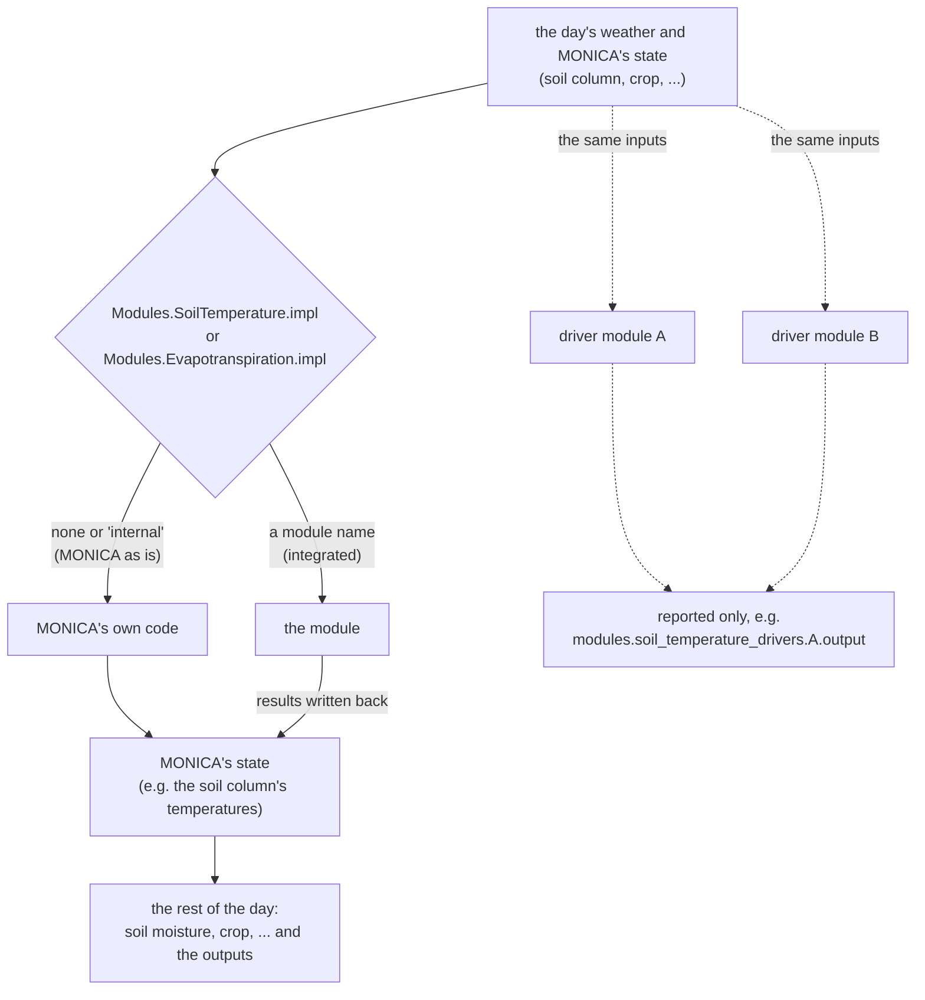
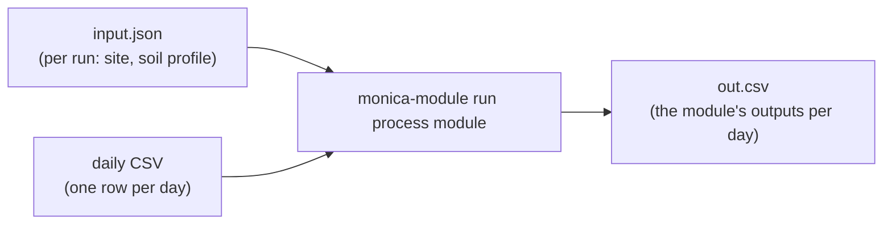
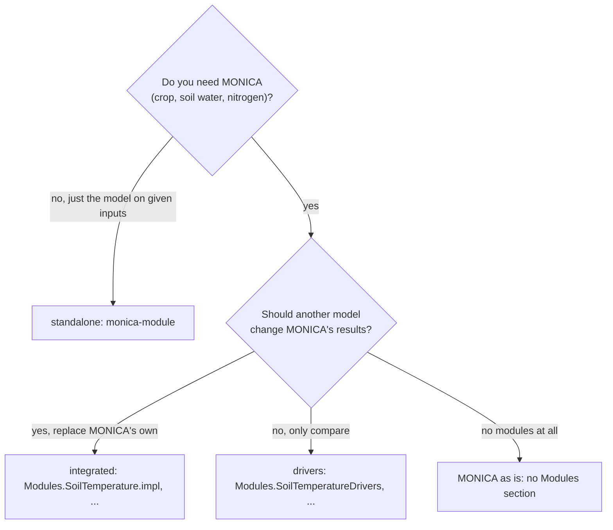

# How to use the Odin MONICA: the ways to run it

The Odin MONICA can run in several ways, and with the swappable modules
(Crop2ML packages, `plan-crop2ml-modules.md`) there are a few more. This page
sorts them out. How to *build* the programs is in `how-to-build.md`.

## In short

| Way | What runs | What it's for | How |
|---|---|---|---|
| **MONICA as is** | MONICA's own code for every process | normal simulations; gives the same results as the C++ MONICA | `monica-run sim.json`, no `"Modules"` |
| **Integrated** | a module *instead of* MONICA's own code for one process; MONICA continues with its results | MONICA with another soil temperature or evapotranspiration model | `"Modules": {"SoilTemperature": {"impl": "<module>"}}` |
| **Driver** | MONICA as is (or with an integrated module), plus modules *alongside* that get the same inputs; their results are only reported | comparing models under identical conditions inside MONICA | `"Modules": {"SoilTemperatureDrivers": ["<module>", ...]}` |
| **Standalone** | one module, without MONICA, on inputs from a file | AMEI exercises, testing a module on given inputs | `monica-module run <process> <module> input.json out.csv` |

Integrated and driver can be combined: one module integrated, others (even the
same one) as drivers.

## A day in MONICA, for one process

Two processes can be swapped so far: **soil temperature** and
**evapotranspiration** (part of the soil moisture step). For each, MONICA's day
goes like this:



- **MONICA as is**: without a `"Modules"` section (or with `"impl": "internal"`)
  nothing of the module machinery runs, and the results are identical to the
  C++ MONICA - CI checks that on every push (`UPDATING_VERSIONS.md`,
  `cpp_reference`).
- **Integrated**: the module replaces MONICA's own code for that process; the
  rest of MONICA (crop, soil moisture, nitrogen, ...) uses its results. Only
  one module per process can be integrated.
- **Drivers**: they get exactly the inputs MONICA's own code (or the integrated
  module) gets that day, step along, and change nothing - MONICA's results are
  the same with or without them. Their inputs, outputs and internal state can
  be written out by output path, next to MONICA's own values.

## Standalone



No MONICA at all: `monica-module` reads the inputs from files, runs the module
day by day and writes its outputs. The input format is in
`cmd/monica-module/main.odin` (soil temperature) and
`cmd/monica-module/evapotranspiration.odin` (evapotranspiration).

    monica-module run SoilTemperature DSSAT_ST_standalone input.json out.csv
    monica-module run Evapotranspiration Monica_AMEI_potential_Evapotranspiration input.json out.csv
    monica-module from-sim sim.json input.json      # soil temperature input from a MONICA sim

For soil temperature, `internal` runs MONICA's own soil temperature code
standalone, and `from-sim` writes an input from a sim.json (site, soil
profile, climate).

## Which module can do what

| Process | Module | Integrated | Driver | Standalone |
|---|---|:---:|:---:|:---:|
| soil temperature | MONICA's own (`internal`) | default | - | yes |
| soil temperature | `Monica_SoilTemp`, `DSSAT_ST_standalone`, `DSSAT_EPICST_standalone`, `ApsimCampbell`, `BiomaSurfacePartonSoilSWATC`, `BiomaSurfaceSWATSoilSWATC`, `Simplace_Soil_Temperature`, `SQ_Soil_Temperature`, `Stics_soil_temperature` | yes | yes | yes |
| evapotranspiration | MONICA's own (`internal`) | default | - | - |
| evapotranspiration | `Monica_Evapotranspiration` (MONICA's own as a Crop2ML package) | yes, not with `"evapotranspiration-method": "FAO-56-Dual"` | yes | yes |
| evapotranspiration | `Monica_AMEI_potential_Evapotranspiration` (only ET0 and potential ET) | no - it has no evaporation, transpiration or soil water | yes | yes |

`Monica_SoilTemp` and `Monica_Evapotranspiration` are MONICA's own code as
Crop2ML packages: integrated, they give MONICA's own results (checked by
`tests/check_drivers.py`).

## Configuration (sim.json)

```json
"Modules": {
  "SoilTemperature": {"impl": "DSSAT_ST_standalone", "mode": "integrated"},
  "SoilTemperatureDrivers": ["Monica_SoilTemp", "ApsimCampbell"],
  "Evapotranspiration": {"impl": "internal"},
  "EvapotranspirationDrivers": ["Monica_Evapotranspiration", "Monica_AMEI_potential_Evapotranspiration"]
}
```

- `impl`: `"internal"` (or no entry) for MONICA's own, or a module name;
  `"mode"` is optional, `"integrated"` is the only one.
- `...Drivers`: the modules to run alongside, in this order.
- A wrong name, an integrated module that can't be integrated, or a module
  listed twice stops the run before it starts, with a message.

`installer/Hohenfinow2/sim-min-amei.json` is a complete example, with the
output columns below.

## Getting the results out

Output columns can name any value by path (`plan-reflective-outputs.md`), with
its unit from the field (`CONVENTIONS.md` §9a) and optionally a `"calc"`:

| What | Path |
|---|---|
| MONICA's values (also with an integrated module) | e.g. `soil_column.layers.soil_temperature`, `soil_moisture.reference_evapotranspiration` |
| a driver's outputs | `modules.soil_temperature_drivers.<name>.output.layer_temperature`, `modules.evapotranspiration_drivers.<name>.output.reference_evapotranspiration` |
| the inputs a driver got | `modules.<process>_drivers.<name>.input.<field>` (daily ones under `input.daily.<field>`) |
| a driver's own internal state | e.g. `modules.soil_temperature_drivers.DSSAT_ST_standalone.module.Dssat_St.s.srftemp` |

```json
{"path": "modules.soil_temperature_drivers.DSSAT_ST_standalone.output.soil_surface_temperature",
 "name": "DSSAT-Monica.Surf", "unit": "K",
 "calc": ["-", "modules.soil_temperature_drivers.Monica_SoilTemp.output.soil_surface_temperature"]}
```

## Which one do I want?



## Not to confuse with

- **The C++ MONICA** (`master`) is a separate program. The Odin MONICA *as is*
  gives the same results; the modules exist only in the Odin MONICA.
- **`src/`** in this repository is the converted C++, an intermediate step of
  the move to Odin, kept until the move is complete and compared with the C++
  in CI (`how-to-build.md`). It has no modules either.
- **The servers** (`monica-zmq-server`, `monica-capnp-server`) run the same
  MONICA as `monica-run`, including the `"Modules"` section of the sim.json
  (env) they get.
